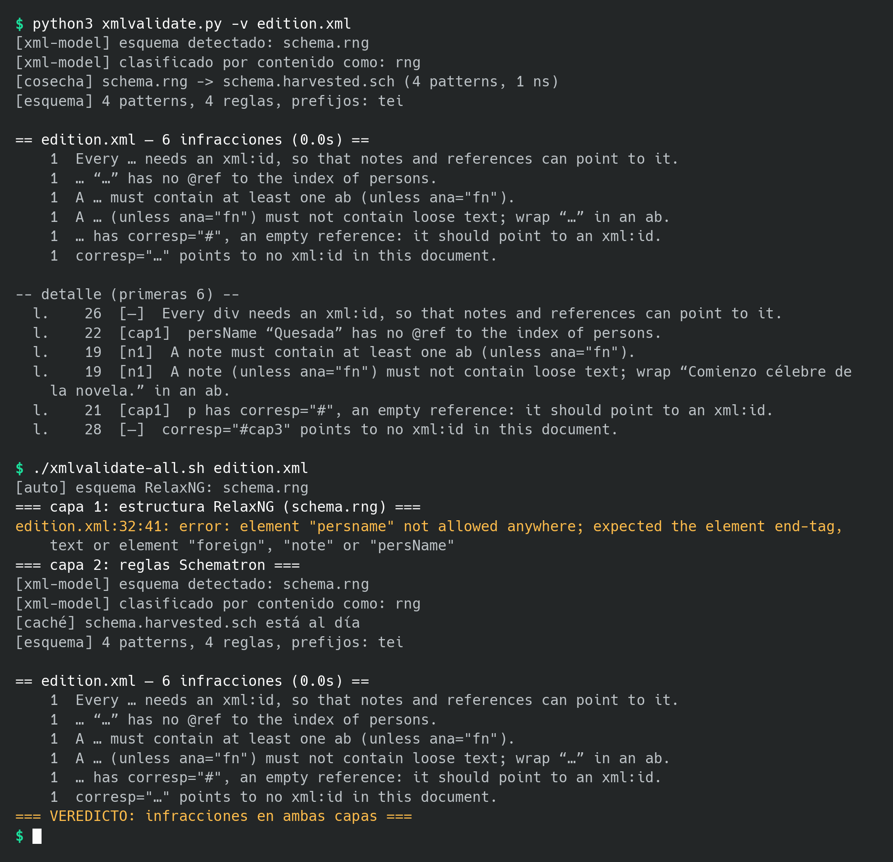

# py-schematron — Schematron validation of TEI documents, in the terminal, VS Code and Emacs

*(Español: [README_es.md](README_es.md))*

**Version 2.1** (`py-schematron.py --version`, `--about`)

Schematron-layer validator for the SMTrad project. It extracts the ISO
Schematron rules embedded in the ODD (`smed-schema.xml`) and runs them
against one or more TEI documents with Saxon (XPath 3.1), producing a
complete report — free of oXygen's display cap — with per-rule counts and,
in verbose mode, the line number and `xml:id` of every offender.

- **The command line** (`py-schematron.py`) runs the Schematron rules of a
  document's schema (an ODD, an ISO Schematron file, or a RelaxNG with the
  rules embedded), which it finds by itself in the document's
  `<?xml-model?>`. **`py-schematron-all.sh`** adds the structural layer, RelaxNG
  with jing, and gives one verdict for both. See [Usage](#3-usage).
- **The VS Code extension**
  ([py-schematron-vscode](https://codeberg.org/nivaca/py-schematron-vscode)) shows the same results in the
  editor, **as you type**: errors underlined in the text, their messages on
  hover, all of them in the Problems panel (Schematron, RelaxNG and
  well-formedness), and the count in the status bar. It is on the
  [Visual Studio Marketplace](https://marketplace.visualstudio.com/items?itemName=NicolasVaughan.validate-schematron) as *Schematron Validator
  (py-schematron)*. See [VS Code extension](#32-vs-code-extension).
- **The Emacs package** ([py-schematron.el](https://codeberg.org/nivaca/py-schematron.el), Emacs 31 or
  later) does the same with Flycheck or Flymake: problems underlined as you
  type, the message under the cursor, all of them in the checker's list, and
  completion from the document's schema. See [Emacs package](#33-emacs-package).

The two plugins have repositories of their own; each carries a copy of
`py-schematron.py`, kept in step with this one (§3.4).

How it was made is told in [`docs/DESCRIPTION.md`](docs/DESCRIPTION.md).

**Why it exists.** oXygen exhibits three silent failure modes documented in
this project's history: the *validation highlights* cap (100 by default;
errors beyond it are dropped without warning), *first-match shadowing*
between rules sharing an identical context, and structurally empty rules
that invalidate the whole schema. This script eliminates the first by
design (it lists everything, or states exactly how many items were left
out), and makes the other two visible by always reporting a verifiable
total count.

## Screenshots

`py-schematron.py` and `py-schematron-all.sh` in the terminal, on the example in
[`docs/example/`](docs/example/) (a short TEI text with deliberate mistakes,
and a small RelaxNG schema with Schematron rules embedded in it):



The VS Code extension (§3.2) on the same document: the errors underlined,
the message of one of them, all of them in the Problems panel with the layer
that found each (Schematron or RelaxNG), and the count in the status bar:


and in a light theme:


The screenshots are made by [`tools/screenshots.py`](tools/screenshots.py),
out of sight and without touching your own settings; its docstring lists
what it needs:

```sh
python3 tools/screenshots.py --python ~/.venvs/schematron/bin/python
```

The VS Code shots use a clone of
[py-schematron-vscode](https://codeberg.org/nivaca/py-schematron-vscode) next
to this repository (`--extension FOLDER` gives another).

---

## 1. Requirements

| Component | Version | Role |
|---|---|---|
| Python | ≥ 3.15 | interpreter |
| [saxonche](https://pypi.org/project/saxonche/) | ≥ 12 | XSLT 3.0 / XPath 3.1 engine (Saxon C) |
| [lxml](https://pypi.org/project/lxml/) | ≥ 4.9 | line-number resolution |
| `extract-isosch.xsl` + `common/functions.xsl` | TEI Stylesheets (`dev` branch) | ODD → `.sch` extraction (only with `-o`) |

Saxon's XPath 3.1 binding is a superset of oXygen's engine, so
`matches()`, `tokenize()`, `some/every … satisfies`, `if/then/else` and the
rules' `<let>` elements evaluate identically in both environments.

## 2. Installation

There are two ways to install py-schematron:

- **With the installer** (§2.1), on Linux, macOS or Windows: one command
  downloads the latest release and sets up everything it needs, in your
  own folders. This is the way to use it.
- **From a clone** of the repository (§2.2), on Linux or macOS: for working
  on py-schematron itself, or to follow its development.

### 2.1 With the installer (Linux, macOS, Windows)

#### What you need

Only **Python 3.15 or later**, and a connection to the internet while
installing. The installer needs no administrator rights, and leaves the
system's Python alone: it makes a Python environment of its own.

To see which Python you have, type in a terminal `python3 --version`
(Linux, macOS) or, in PowerShell, `py --list` or `python --version`
(Windows). If it is older than 3.15, or missing:

- **Linux:** install it with your system's packages: on Fedora,
  `sudo dnf install python3.15`; on Debian and Ubuntu,
  `sudo apt install python3.15 python3.15-venv` (where your release does
  not have it yet, the [deadsnakes PPA](https://launchpad.net/~deadsnakes/+archive/ubuntu/ppa)
  does). On Debian and Ubuntu, `python3.15-venv` is needed too.
- **macOS:** download the installer from
  [python.org](https://www.python.org/downloads/macos/) and open it, or
  use Homebrew: `brew install python@3.15`.
- **Windows:** download the installer from
  [python.org](https://www.python.org/downloads/windows/) and run it (it
  also installs the `py` launcher, which the installer looks for), or type
  in PowerShell `winget install Python.Python.3.15`.

#### Linux and macOS

Open a terminal (on macOS: Applications › Utilities › Terminal) and type:

```sh
curl -LsSf https://raw.githubusercontent.com/nivaca/py-schematron/main/installers/install.sh | sh
```

When it is done, it says where it put everything and how to try it:

```sh
py-schematron.py --about
py-schematron.py document.xml
py-schematron-all.sh document.xml
```

The commands go into `~/bin` if that folder exists, or else into
`~/.local/bin`. If the installer says that the folder is not on your PATH
(so that the terminal answers *command not found*), add it: on macOS,
whose terminal uses zsh, add the line
`export PATH="$HOME/.local/bin:$PATH"` to `~/.zshrc`; on Linux, to
`~/.profile` or `~/.bashrc`. Then open a new terminal.

#### Windows

Open PowerShell (Start menu › type *PowerShell*) and type:

```powershell
powershell -ExecutionPolicy ByPass -c "irm https://raw.githubusercontent.com/nivaca/py-schematron/main/installers/install.ps1 | iex"
```

The installer adds its commands' folder to your PATH. **Close PowerShell
and open it again**, so that it sees the new PATH; then:

```powershell
py-schematron --about
py-schematron document.xml
```

On Windows the command is `py-schematron`, without `.py`.
`py-schematron-all.sh`, a shell script, does not run on Windows; for the
structure (RelaxNG), see *jing* below.

`-ExecutionPolicy ByPass` lets that one command run without changing your
system's settings. If your organisation's policy forbids scripts
altogether, download `py-schematron-v.X.Y.zip` from the
[releases](https://github.com/nivaca/py-schematron/releases), unzip it,
and, in the folder it makes, run `py installers\install.py --from .`.

#### What the installer does

1. It looks for Python 3.15 or later, and says where to get it if there is
   none.
2. In a folder of its own, `~/.local/share/py-schematron` (Linux),
   `~/Library/Application Support/py-schematron` (macOS) or
   `%LOCALAPPDATA%\py-schematron` (Windows), it puts:
   - `program/`: the latest release of py-schematron, downloaded from
     GitHub (or from Codeberg, if GitHub cannot be reached), with the two
     TEI stylesheets that `-o` (rules from an ODD) needs, downloaded from
     [TEIC/Stylesheets](https://github.com/TEIC/Stylesheets);
   - `venv/`: a Python environment with saxonche and lxml, installed with
     pip.
3. It makes the commands, which run the program with that environment:
   `py-schematron.py` and `py-schematron-all.sh` in `~/bin` or
   `~/.local/bin` (Linux, macOS), or `py-schematron` in the folder's
   `bin\`, which it adds to your PATH (Windows).

A command of the same name that the installer did not make, such as a link
made from a clone by `py-schematron-install.py` (§2.2), is left alone; the
installer says so, and `--force` replaces it.

#### Updating, options, uninstalling

Run the same command again to update to the latest release; the schemas
already downloaded are kept. To pass options to it, put them after
`sh -s --` (Linux, macOS), as in:

```sh
curl -LsSf https://raw.githubusercontent.com/nivaca/py-schematron/main/installers/install.sh | sh -s -- --uninstall
```

or, on Windows, download `installers\install.ps1` and run
`powershell -ExecutionPolicy ByPass -File install.ps1 --uninstall`. With a
copy of the repository, run `sh installers/install.sh` or
`installers\install.ps1` directly. The options are:

| Option | Effect |
|---|---|
| `--version X` | Install release X (for instance `2.0`) instead of the latest |
| `--from ZIP-OR-FOLDER` | Install from a release zip, or from a folder (a clone), instead of downloading |
| `--no-tei-stylesheets` | Do not download the TEI stylesheets (`-o` then needs `--stylesheets`, §2.2) |
| `--force` | Replace commands of the same name that the installer did not make |
| `--uninstall` | Remove the installer's folder and its commands (and, on Windows, its PATH entry), and nothing else |

#### jing (optional)

`py-schematron.py` checks the Schematron rules. The structure (RelaxNG) is
checked by [jing](https://relaxng.org/jclark/jing.html), which
`py-schematron-all.sh` and the editor plugins use if it is installed. The
installer says if it is missing:

- **Linux:** `sudo dnf install jing` (Fedora) or `sudo apt install jing`
  (Debian, Ubuntu).
- **macOS:** `brew install jing-trang`.
- **Windows:** jing needs Java (`winget install EclipseAdoptium.Temurin.21.JRE`)
  and `jing.jar`, from the zip of a
  [jing-trang release](https://github.com/relaxng/jing-trang/releases);
  then `java -jar C:\path\to\jing.jar schema.rng document.xml` checks a
  document.

#### With the editor plugins

The [VS Code extension](https://codeberg.org/nivaca/py-schematron-vscode)
and the [Emacs package](https://codeberg.org/nivaca/py-schematron.el)
bring their own copy of py-schematron.py, but need a Python with saxonche
and lxml. The installer's environment has them, and the plugins (VS Code
extension 0.11 and Emacs package 0.9, and later) use its Python by
themselves while their Python setting is empty: run the installer, and
there is nothing to set. Its Python is here, for older versions or other
uses:

| System | The installer's Python |
|---|---|
| Linux | `~/.local/share/py-schematron/venv/bin/python` |
| macOS | `~/Library/Application Support/py-schematron/venv/bin/python` |
| Windows | `%LOCALAPPDATA%\py-schematron\venv\Scripts\python.exe` |

A Python named in the plugin's setting (`schematron.pythonPath` in VS Code,
`py-schematron-python` in Emacs) still takes precedence.

#### If something goes wrong

| What you see | What to do |
|---|---|
| *needs Python 3.15 or later, and none was found* | Install it (see *What you need*), open a new terminal, and run the installer again |
| *a Python environment could not be made* (Debian, Ubuntu) | `sudo apt install python3.15-venv`, and run it again |
| *command not found* after installing (Linux, macOS) | The commands' folder is not on your PATH: see *Linux and macOS* above |
| `py-schematron` is not recognised (Windows) | Close PowerShell and open it again; the PATH is read when it starts |
| *running scripts is disabled on this system* (Windows) | Use the command exactly as above, with `-ExecutionPolicy ByPass` |
| *the latest release could not be found* | No connection to GitHub or Codeberg: download the release zip elsewhere and use `--from` |
| *the TEI stylesheets could not be downloaded* | Everything works except `-o`; run the installer again later, or use `--stylesheets` (§2.2) |

### 2.2 From a clone (Linux, macOS)

```sh
git clone https://codeberg.org/nivaca/py-schematron.git    # or https://github.com/nivaca/py-schematron.git
cd py-schematron
```

```sh
# 1. Python dependencies
pip install saxonche lxml

# 2. TEI stylesheets (only needed for extraction with -o), if you have no
#    clone of TEIC/Stylesheets (see below). The folder layout must be
#    preserved, because extract-isosch.xsl imports ../common/functions.xsl:
mkdir -p odds common
curl -sL -o odds/extract-isosch.xsl \
  https://raw.githubusercontent.com/TEIC/Stylesheets/dev/odds/extract-isosch.xsl
curl -sL -o common/functions.xsl \
  https://raw.githubusercontent.com/TEIC/Stylesheets/dev/common/functions.xsl
```

Resulting layout:

```
py-schematron/
├── py-schematron.py
├── py-schematron-all.sh
├── py-schematron-install.py
├── odds/
│   └── extract-isosch.xsl
└── common/
    └── functions.xsl
```

Paths to `odds/` and `common/` are resolved relative to the script
(`Path(__file__).parent`), not to the working directory: you can invoke it
from anywhere.

If you already have the TEI Stylesheets (a clone of
[TEIC/Stylesheets](https://github.com/TEIC/Stylesheets), or oXygen's copy),
`-o` can use them instead of copies next to the script. It looks, in this
order, at `--stylesheets DIR`, the environment variable `TEI_STYLESHEETS`,
the `stylesheets` setting of
[ODD2RNG](https://codeberg.org/nivaca/ODD2RNG)'s configuration file
(`~/.config/odd2rng/config.toml`), and last `odds/` and `common/` next to
the script. `py-schematron.py --about` says which folder it uses.

#### The commands in `~/bin`


To run the scripts by name from any folder, link them into `~/bin`:

```sh
python3 py-schematron-install.py
```

It makes two symbolic links, `~/bin/py-schematron.py` and
`~/bin/py-schematron-all.sh`, that point to this folder, so a `git pull`
here updates the commands at once; run it again after moving the folder.
An existing file or another link with the same name is left alone
(`--force` replaces another link, never a file). `--uninstall` removes only
its own links, and `--bin FOLDER` puts them somewhere else.

The commands run with the first `python3` on your PATH, which needs saxonche
and lxml. The installer checks this and, if they are missing, shows the
command that installs them (`python3 -m pip install --user saxonche lxml`).
A virtual environment works as well, if its `bin/` folder comes first on
your PATH.

### 2.3 Tests

```sh
python3 -m unittest discover -s tests -v
```

runs the tests of `py-schematron.py`, `py-schematron-all.sh` and
`py-schematron-install.py` (`tests/test_py_schematron.py`), with the
Python that runs them, which needs saxonche and lxml; nothing else is
needed. They write small documents and schemas for each case in a temporary
folder, with their own copy of the scripts, so nothing lands in this one:
rules and messages, first-match shadowing, `let`s at every level and
`current()`, broken rules and the exit codes, malformed documents, the
sources of rules (`-s`, `-r`, `<?xml-model?>`, `--as`), the cache, a remote
schema served from a small local web server, with `--refresh`, the text
report, and the installer. The ODD tests need the TEI stylesheets in
`odds/` and `common/`, and the tests of `py-schematron-all.sh` need jing;
without them they are skipped. The tests do not read your own
`TEI_STYLESHEETS` or ODD2RNG configuration.

`tests/test_installers.py` tests the installer of §2.1 without network or
pip: the folders of each system, the commands it writes, an update that
keeps the cache, a command it did not make, and the removal.

On GitHub the tests run at every push and every Monday
(`.github/workflows/tests.yml`), with jing and the two stylesheets, so that
none is skipped. Another job installs py-schematron for real with
`installers/` on Linux, macOS and Windows, as a user would, then runs the
command, validates a document and uninstalls it.

## 3. Usage

```
python3 py-schematron.py [-o ODD | -s SCH | -r RNG] [-v] [--max N] [--refresh] [--json] [--as PATH] DOC.xml [...]
```

Since v1.2, the schema flags are **optional**: without them, the schema is
**auto-detected** from the first document's `<?xml-model?>` PIs (§3.1).

| Option | Effect |
|---|---|
| `-o, --odd PATH` | Extracts the `.sch` from an ODD **with embedded Schematron** (cached, §4) and validates against it. An ODD without embedded rules (e.g. an uncompiled `tei_all.odd`) is rejected with a message, rather than validated against an empty schema (§7) |
| `-s, --sch PATH` | Uses an already-extracted `.sch`; skips extraction |
| `-r, --rng PATH` | **Harvests** the `sch:ns`/`sch:pattern` annotations embedded in an ODD-generated RelaxNG (deduplicated, cached) and validates against them — the very rules Jing ignores |
| `-v, --verbose` | Detailed listing: line, `xml:id`, message per offender |
| `--max N` | Maximum offenders in the detailed listing (default 50). If there are more, the script **says how many were left out** — it never truncates silently |
| `--refresh` | With auto-detection: re-download a remote schema even if cached |
| `--json` | Machine-readable report on stdout: every violation (pattern, context, assert/report, `role`, message, interpolated text, `fn:path`, line, `xml:id`), XPath errors per rule, and the schema source; ignores `-v`/`--max`. A malformed document becomes an `error` entry instead of aborting the run. Progress messages still go to stderr, and since 1.21 they are also in `events`, one object each, with a stable `kind` (`xml-model`, `download`, `cache`, `extraction`, `harvest`, `schema`, `warning`), the message, and their data (`url`, `file`, `patterns`…). A fatal error (exit 3) still gives JSON: `{"version", "error", "events"}`. The plugins read these, not stderr. Since 1.21 each violation and XPath error also has `rule`, `{"file", "line"}` of its assert or report: in the ODD or the RelaxNG it came from with `-o`, `-r` or auto-detection (the file one edits), not in the `.sch` made from them; the plugins use it to jump to the rule |
| `--as PATH` | With a single document: treat it as if it were located at PATH, for resolving relative `xml-model` hrefs and for the name in the report. The VS Code extension uses it to validate unsaved text from a temporary copy |
| `--stylesheets DIR` | The TEI Stylesheets for `-o`, instead of `TEI_STYLESHEETS`, ODD2RNG's configuration or `odds/` next to the script (§2) |
| `--about` | What this program is, who made it, its licence and where it lives, and what it runs with here: Python, saxonche, lxml, Saxon, the cache folder, and whether the TEI stylesheets for `-o` are present. With `--version`, the only options that need no document |

The three explicit sources are mutually exclusive; when none is given,
auto-detection takes over.

### 3.1 Auto-detection via `<?xml-model?>` (v1.2)

Without `-o/-s/-r`, the script reads the first document's `xml-model` PIs
and:

1. **Picks the href**: preferably the one with the Schematron
   `schematypens`; failing that, the RelaxNG one (its embedded Schematron
   will be harvested). The common pattern — the same `.rng` associated
   twice, once per layer — converges on a single source.
2. **Resolves the path**: relative *to the document* (not to the working
   directory), absolute, or an http(s) URL — downloaded to
   `.schema-cache/` next to the script (name = URL hash + original
   filename) and reused on later runs; `--refresh` forces a re-download.
   Note: unlike the mtime cache, the URL cache cannot detect remote
   updates — after a new schema release, use `--refresh`.
3. **Classifies by actual content**, not by extension or declaration:
   RelaxNG root → harvest; ISO Schematron root → direct use; TEI root
   (ODD) → extraction. With several documents, the schema is detected from
   the first one (with a notice). No PI and no flags: exit 3 with a
   message.

The minimal invocation thus becomes simply:

```sh
python3 py-schematron.py document.xml
```

### Recipes

```sh
# Daily cycle: extract if needed and validate
python3 py-schematron.py -o ../smed-schema/smed-schema.xml ../salmarc_ed_lat.xml

# Full report for a correction campaign
python3 py-schematron.py -o ../smed-schema/smed-schema.xml -v --max 999 \
    ../salmarc_ed_lat.xml > pending.txt

# Several documents against a fixed .sch
python3 py-schematron.py -s smed-schema.sch -v ed_lat.xml ed_es.xml

# Against the Guidelines' Schematron, harvested from the tei_all RNG (§7)
python3 py-schematron.py -r tei_all.rng -v document.xml

# One artifact for both layers: structure with Jing, rules with -r
jing smed-schema.rng ed_lat.xml && python3 py-schematron.py -r smed-schema.rng ed_lat.xml

# Or with the two-layer wrapper (ALWAYS runs both layers, no short-circuit,
# with a composite verdict: 0 clean, 1 RelaxNG, 2 Schematron, 3 both,
# 4 environment error or incomplete Schematron check;
# falls back to lxml's RelaxNG when jing is not installed):
./py-schematron-all.sh -v smed-schema.rng ed_lat.xml

# Wrapper in auto mode (v1.2): without a schema argument, it detects the
# schema from the document's xml-model PI (classifying the first argument
# by content, not by extension) and shares py-schematron.py's download cache:
./py-schematron-all.sh -v document.xml

# In a Makefile or pre-commit hook (non-zero exit code on violations)
python3 py-schematron.py -s smed-schema.sch ed_lat.xml || echo "pending issues"
```

### Exit codes

| Code | Meaning |
|---|---|
| 0 | no violations |
| 1 | one or more violations |
| 2 | invocation error (argparse) |
| 3 | the validation could not be completed: a document that is not well-formed, a rule that could not be evaluated (an XPath error; the report lists it, and the other rules are still checked), or an environment error (missing file, ODD/RNG without rules), with a message on stderr |

### 3.2 VS Code extension

The extension for Visual Studio Code lives in its own repository,
[py-schematron-vscode](https://codeberg.org/nivaca/py-schematron-vscode) (also on
[GitHub](https://github.com/nivaca/py-schematron-vscode)), and on the
[Visual Studio Marketplace](https://marketplace.visualstudio.com/items?itemName=NicolasVaughan.validate-schematron) as *Schematron Validator
(py-schematron)*. It runs its copy of `py-schematron.py --json`, and jing
when the schema is RelaxNG, and shows the results as diagnostics in the
editor and the Problems panel:

- **When:** as you type (once typing pauses for half a second, a setting),
  on open and on save, for every `.xml` file with an `<?xml-model?>`.
  Unsaved changes are validated from a private temporary copy; your file is
  never written.
- **What you see:** each error underlined, with its message on hover and
  its layer (**Schematron**, **RelaxNG**, or **XML** when the document is
  not well-formed); a misspelt element is flagged where it was opened. The
  status bar shows the current file's result: a tick when it is clean, the
  number of problems, or "failed" when validation could not run.
- **Commands** (Ctrl+Shift+P, "Schematron"): *Validate Current File*,
  *Refresh Schema* (download a remote schema again after it changed),
  *Select Python Interpreter…*, *Show Output* and *Clear Diagnostics*.

**Install:** from the Extensions view (search "Schematron Validator"), or
with the `.vsix` of a release of py-schematron-vscode and
`code --install-extension validate-schematron-*.vsix`. Then point
`schematron.pythonPath` at a Python that has saxonche and lxml (the
extension offers to choose one if needed). Settings, requirements, building
from source and details are in its
[README](https://codeberg.org/nivaca/py-schematron-vscode#schematron-validator-for-vs-code).

### 3.3 Emacs package

The Emacs package lives in its own repository,
[py-schematron.el](https://codeberg.org/nivaca/py-schematron.el) (also on
[GitHub](https://github.com/nivaca/py-schematron.el)). It is a Flycheck
checker and a Flymake backend for Emacs 31 or later, and uses Flycheck when
it is installed. It runs its copy of `py-schematron.py --json` the same way
the VS Code extension does, with jing for RelaxNG schemas, and shows the
results in the buffer: each problem underlined, its message when the cursor
is on it, with its layer (Schematron, RelaxNG or XML) and pattern, and all
of them in the checker's list. In nxml-mode it also gives nxml the
document's RelaxNG schema (converted with trang), so that `C-RET` completes
the elements and attributes the schema allows. It checks as you type, from
a private temporary copy, and a new check cancels the one still running.

**Install**, with Straight:

```elisp
(use-package py-schematron
  :straight (:host codeberg :repo "nivaca/py-schematron.el")
  :hook (nxml-mode . py-schematron-mode))
(setopt trusted-content '("~/path/to/your/editions/"))
```

or with package-vc, `(package-vc-install '(py-schematron :url
"https://codeberg.org/nivaca/py-schematron.el"))`. Flymake checks only files in `trusted-content`, and the
package keeps that rule with Flycheck too, because the schema a document
names is run by Saxon, and its XPath can read files and fetch URLs. Until
version 0.2.0 the package was in the `emacs/` folder of this repository;
recipes that point here (with `:lisp-dir "emacs"` or `:files
("emacs/*.el")`) must change to the one above. Settings, commands, trang
and tests are in its [README](https://codeberg.org/nivaca/py-schematron.el#py-schematron-for-emacs).

### 3.4 The plugins' copies of py-schematron.py

Each plugin carries its own copy of `py-schematron.py`, at the top of its
repository, so that it installs on its own. After changing the script here,

```sh
python3 tools/sync-plugins.py           # copy it into ../py-schematron.el and ../py-schematron-vscode
python3 tools/sync-plugins.py --check   # only say whether the copies are the same (exit 1 if not)
```

copies it into the clones of the two plugins next to this repository
(`--emacs FOLDER` and `--vscode FOLDER` give others) and says which copies
changed, from which version. It commits nothing: the copy is then committed
and released in each plugin, whose changelog says which version it carries.
It copies `tools/release.py` too, the release script the three repositories
share (ODD2RNG uses it as well, with a copy made by hand).

### 3.5 Releases

```sh
python3 tools/release.py --dry-run   # check, test and build; say what would follow
python3 tools/release.py             # then tag, push and release
```

releases the version in `py-schematron.py`, with the notes of its row in
the version history (§11) or those of `--notes FILE`. It checks that the
tree is committed and the tag new, runs the tests, makes the zip
(`tools/bundle-zip.py`), tags the commit, pushes `main` and the tag to
Codeberg and GitHub, makes the release on both (with `tea` and `gh`),
attaches the zip, and downloads it from both to compare it with the local
one. A step already done is skipped, so after a failure it can be run again.
In each plugin the same script releases the plugin, with the notes of its
changelog, and first checks that its copy of `py-schematron.py` is the
same as this one.

## 4. Configuration and caching

- **Extraction cache**: with `-o`, the `.sch` is written next to the ODD
  (same name, `.sch` extension); with `-r`, next to the RNG
  (`.harvested.sch` extension). They are regenerated when the mtime of the source **or of the
  script itself** is newer — updating `py-schematron.py` automatically
  invalidates all derivatives, so a fixed generator never coexists with
  derivatives produced by the defective version. The `[caché] ... está al día` message indicates a cache
  hit. To force regeneration: `touch` the source or delete the derivative.
- **Namespace prefixes**: read from the `<ns>` elements of the `.sch`
  itself (currently only `tei:`). Nothing to configure by hand.
- **No configuration file**: all observable state lives in the command line
  and in the two artifacts (ODD, `.sch`).

## 5. How it works

### Pipeline

1. **Extraction** (`-o` only): Saxon applies `extract-isosch.xsl` to the
   ODD and produces the ISO Schematron with `queryBinding="xslt2"` — one
   `pattern` per `constraintSpec`, as the standard TEI chain does.
2. **Rule loading**: lxml parses the `.sch` and builds the list of
   patterns → rules → (`context`, `let*`, `assert`/`report` tests).
3. **Execution**: for each rule, context nodes are located with Saxon
   (`//(context)` for relative contexts; absolute ones as-is) and each test
   is evaluated as an *effective boolean value* in XPath 3.1. `<let>`
   elements are translated to the native `let $x := (...) return (...)`.
4. **Harvest self-check** (`-r` only): the freshly written
   `.harvested.sch` is re-parsed and its counts compared with what was
   harvested; on mismatch (serialization corruption) the script exits with
   code 3 instead of validating against a mutilated schema.
5. **Report**: aggregate counts per rule message; with `-v`, each offender
   is resolved to a physical line and `xml:id` via `fn:path()` (Saxon) →
   conversion of the `Q{uri}` notation to prefixes → node lookup with lxml
   (`sourceline` + nearest ancestor bearing `@xml:id`).

### ISO Schematron semantics implemented

Covered — the exact subset the smed ODD uses:

- `pattern`, `rule`, `assert`, `report`, `let`. A `let` at schema or
  pattern level is evaluated with the document's root as context, and a
  rule's `let` with the rule's node, as the standard says (before 1.18 all of
  them took the rule's node); pattern-level variables can also be used in
  the rule's context;
- `current()` (an XSLT function used by the P5 Guidelines rules): translated
  into a context-node binding (`let $VALIDATE_CTX := .`) with textual
  substitution, which reproduces its Schematron semantics exactly;
- **first-match shadowing within each pattern**: a node matched by an
  earlier rule of the same pattern is excluded from later ones, per the
  standard. (The TEI extraction emits one pattern per constraintSpec, which
  makes shadowing *across* constraintSpecs impossible by construction — the
  runner honors it regardless, for fidelity.)

Not implemented — the script **warns on stderr once per kind** and
continues: `phase` (all patterns are run), abstract patterns/rules
(skipped), `diagnostics`, `xsl:key`, and elements from other namespaces such as `sqf:fix` (oXygen Quick Fixes, which
do not affect verdicts). None of this occurs with the smed ODD; with
Guidelines Schematron (§7) you will see the `sqf` notice.

### Performance

Small documents are checked in a tenth of a second. Starting the script
costs almost nothing (Python with saxonche and lxml loads in about 15 ms):
the time goes into evaluating the rules, and two changes made that much
faster on large documents. On the Latin edition, `salmarc_ed_lat.xml`
(about 26,000 lines and 2,000 `<app>` elements), version 1.15 brought the
check from 13.9 s to 3.5 s, and version 1.16 made it about six times faster
again: measured one after the other on the same (busy) machine, 11.5 s with
1.15 and 1.9 s with 1.16. The results were identical on 39 documents.

Since version 1.15, all the tests of a rule are evaluated together, in one
call per node, so the rule's `<let>` variables are computed once per node,
as ISO Schematron intends; before, each test computed them again. In the
smed schema, whose `<app>` rule has seven tests sharing seven costly
variables, that brought the Latin edition from 13.9 s to 3.5 s, with the
same results. If a combined call fails, the rule's tests are evaluated one by
one, so a broken test is still reported on its own.

Since version 1.16, each rule is evaluated in one call for all its context
nodes, not one call per node. Saxon compiles every expression it is given,
so calling it once per node compiled the rule's expression thousands of
times; on the `<app>` rule, that compiling took 9 s of the 9.6 s. The single
call returns, for each node, its `path()` (for first-match shadowing) and
the result of each test; only violations go back to Saxon, to fill in their
messages. Nodes that an earlier rule shadows are evaluated too and their
results ignored. If the single call fails (a test that raises an error, for
instance), the rule is evaluated node by node as before, so shadowed nodes
are skipped and a broken test is reported on its own.

What remains is the variables' own work, such as `//*[@xml:id = ...]`
scans; should they ever matter, the alternative documented in the ODD is
`id()` on a Saxon engine.

## 6. Reading the output

```
[caché] smed-schema.sch está al día
[esquema] 28 patterns, 28 reglas, prefijos: tei

== salmarc_ed_lat.xml — 250 infracciones (0.8s) ==
  219  Empty lem must have a corresp attribute.
   30  An empty lem must be followed by an rdg with @type="variation-present".
    1  Every pointer in the corresp attribute of this empty lem must be ...

-- detalle (primeras 300) --
  l.  2637  [o5h_cfj_2cc]  An empty lem must be followed by an rdg with ...
```

- The `[...]` lines go to **stderr** (the script's own diagnostics); the
  report goes to **stdout** — redirecting with `> pending.txt` captures the
  report only. (Runtime messages are in Spanish; rule messages come from
  the schema itself.)
- In the detail, the `xml:id` is that of the **nearest identifiable
  ancestor** of the offending node (typically the `<app>`), and the line is
  that of the offending node itself in the source file.
- The total in the header is always exact; `--max` limits only the listing,
  never the count.

## 7. Validating against a standard ODD (tei_all and friends)

A stock customization ODD such as `tei_all.odd` is a manifest of
`moduleRef`s: its Schematron rules live in the Guidelines sources
(`p5subset.xml`), not in the file itself. That is why `-o` **rejects** it
with exit code 3 instead of validating against an empty schema that would
approve any document. Two routes:

- **Canonical route**: compile the ODD against `p5subset.xml` with
  `odd2odd.xsl` (full TEI chain; requires cloning the Stylesheets
  repository) and feed the compiled ODD to `-o`.
- **Pragmatic route (recommended)**: `-r tei_all.rng`. The RelaxNG
  distributed by TEI and by oXygen
  (`frameworks/tei/xml/tei/custom/schema/relaxng/`) carries exactly the
  same rules embedded; the script harvests, deduplicates and runs them.
  Bear in mind that with a standard schema the proportions are the reverse
  of smed's: the bulk of standard validation is the RelaxNG layer (Jing),
  and P5's Schematron adds only a few dozen co-constraints — here the
  runner is the side dish, not the main course.


**Where to get `tei_all.rng`** (do not generate it: it is distributed
precompiled, with the Guidelines' Schematron embedded):

```sh
# official TEI release (the most recent):
curl -sLO https://www.tei-c.org/release/xml/tei/custom/schema/relaxng/tei_all.rng
# or the one shipped with your oXygen (same P5 version as your editor):
#   $OXYGEN_HOME/frameworks/tei/xml/tei/custom/schema/relaxng/tei_all.rng
```

Pick **one** source and use it for both layers: mixing oXygen's `.rng` in
Jing with tei-c.org's in the runner (or vice versa) can yield inter-layer
discrepancies due to P5 version differences.

**Complete two-layer recipe against the standard:**

```sh
jing tei_all.rng document.xml && python3 py-schematron.py -r tei_all.rng document.xml
```

The `&&` stops at the first failing layer; after the runner, `$? -eq 1`
unambiguously means "Schematron violations" (not an environment error,
which is 3). The first run harvests to `tei_all.harvested.sch` (far more
patterns than a project schema: tei_all includes every module); subsequent
runs hit the cache.

A note on counts: an ODD-generated `.rng` embeds, besides your own rules,
the Guidelines' Schematron for every included module (e.g. "Abstract model
violation: Lines may not contain hi", P5's rule on `tei:l`). The `-r` route
therefore validates a **superset** of the `-o` route — more patterns, and
potentially new violations that oXygen would report as well. Harvested
patterns left without usable rules (empty or abstract) are dropped, which
is why the `[esquema]` figure can be lower than the `[cosecha]` one.

The `-r` route works equally well with your **own** `.rng`: a single
artifact then feeds both layers (structure with Jing, rules with the
runner), removing the risk of a `.rng` and a `.sch` drifting apart through
asymmetric regeneration.

## 8. What this script does NOT validate

The **RelaxNG structural layer** (content models, permitted attributes) is
the business of the `.rng` generated from the same ODD. From the terminal:

```sh
jing smed-schema.rng salmarc_ed_lat.xml     # apt install jing / brew install jing
```

Jing ignores the Schematron embedded in the RNG — precisely the gap this
script fills. The two commands together replicate oXygen's full validation,
without caps and with machine-processable output.

## 9. Known problems and troubleshooting

| Symptom | Cause | Remedy |
|---|---|---|
| `OSError: failed to load external entity "X.xml"` | The document does not exist at the given path (lxml's cryptic message) | Check the path; recent versions of the script check first (`No existe el documento: /absolute/path`) |
| `No encuentro .../odds/extract-isosch.xsl` | TEI stylesheets missing, or wrong folder layout | Repeat §2, preserving `odds/` and `common/` next to the script |
| `XTSE0165 ... functions.xsl` | `extract-isosch.xsl` present but `common/functions.xsl` missing | Download the second stylesheet |
| `[ERROR XPath] regla '...'` | A `.sch` test fails to compile/evaluate in XPath 3.1 | Inspect that rule in the ODD; all other rules keep running |
| `[aviso] elemento Schematron no implementado: X` | The `.sch` uses constructs outside the subset (§5) | Extend the runner or reformulate the rule |
| The `.sch` does not reflect a recent ODD/RNG change | mtime cache with odd clocks/copies (Dropbox) | `touch` the source or delete the derivative (`.sch` / `.harvested.sch`) |
| `El ODD X no contiene Schematron embebido` (exit 3) | Uncompiled customization ODD (e.g. `tei_all.odd`) | Use `-r` on its generated RNG, or compile with `odd2odd` (§7). Saxon prints its own `XTMM9000` error first: same diagnosis, raw form |
| `El RelaxNG X no contiene anotaciones Schematron` (exit 3) | RNG generated without embedded rules | Regenerate it from the ODD with the standard chain, or use `-o`/`-s` |
| `[aviso] elementos ajenos a Schematron ignorados (p. ej. fix ...)` | Guidelines Schematron (§7) | Informational; verdicts are unaffected |
| `[aviso] elementos ajenos a Schematron ignorados (p. ej. ... de http://www.tei-c.org/ns/1.0)` with script versions before 2026-07-12, or `Self-check de cosecha fallido` | Historical harvester bug: lxml serialized with stale namespace declarations and the `.harvested.sch` came out corrupted (lost patterns/rules, empty prefixes, `Namespace prefix 'tei' has not been declared`) | Update the script (≥ 2026-07-12, with `cleanup_namespaces` + self-check) and delete existing `.harvested.sch` files; the dual-mtime cache handles this automatically from now on |
| Counts differ from oXygen's | oXygen's highlights cap, or a stale `.rng` in oXygen | Raise the cap (Options → Preferences → Editor → Document Checking) and regenerate the `.rng`; the script's figure is the exact one |

## 10. Design history

Decisions best not re-litigated without rereading the project's history:

- **A purpose-built runner rather than a packaged implementation**:
  `pyschematron` (XPath 2.0 in pure Python) takes minutes on this corpus
  because of the `//*[@xml:id=…]` scans; Jing does not support
  `queryBinding="xslt2"`; SchXslt requires managing additional XSLT
  artifacts. Saxon via `saxonche` was already a project dependency and
  delivers C-level speed with the correct binding.
- **No hidden cap**: the `--max 50` default limits the *detail*, but the
  script always states the total and how many items were left unlisted — a
  direct answer to the oXygen cap episode (July 2026).
- **Rejection of empty schemas**: an ODD or RNG without rules terminates
  with exit code 3 instead of "validating" vacuously — closing off the
  fourth possible silent failure mode (a contentless schema that approves
  everything).
- **One pattern per constraintSpec**: inherited from the TEI extraction; it
  makes the cross-constraintSpec shadowing that afflicted older versions of
  the schema structurally impossible.

## 11. Version history

| Version | Date | Changes |
|---|---|---|
| **2.1** | 2026-11-19 | **Installers for Linux, macOS and Windows** (`installers/`, §2.1): one command downloads the latest release and sets it up in the user's folders, with a Python environment of its own (saxonche, lxml), the two TEI stylesheets for `-o`, and the commands on the PATH; run again, it updates, and `--uninstall` removes it. Detailed instructions for each system, in English and Spanish. `py-schematron-all.sh` takes its Python from `PY_SCHEMATRON_PYTHON`. 45 tests; GitHub also installs it for real on the three systems. The VS Code extension (0.11) and the Emacs package (0.9) use the installer's Python by themselves. The validation is the same |
| 2.0 | 2026-11-19 | **The project is renamed py-schematron** (it was py-xmlvalidate): the scripts are `py-schematron.py`, `py-schematron-all.sh` and `py-schematron-install.py`, the repositories nivaca/py-schematron, nivaca/py-schematron.el (the Emacs package) and nivaca/py-schematron-vscode (the VS Code extension, whose name does not change), and the release zip `py-schematron-v.X.Y.zip`. The old repository addresses redirect to the new ones. Run `py-schematron-install.py` again: it links the new names into `~/bin` and removes the old links. The validation is the same |
| 1.21 | 2026-11-19 | With `--json`, the progress messages are also `events` in the report (download, cache, extraction, harvest…), with stable kinds and their data, and a fatal error gives JSON with its message; the plugins read these instead of the Spanish messages on stderr. Each violation and XPath error says where its rule is (`rule`: file and line, in the ODD or RelaxNG it came from), so that the plugins can jump to it. 35 tests, which run every Monday too. The validation is the same |
| 1.20 | 2026-11-18 | `-o` finds the TEI Stylesheets through `--stylesheets DIR`, `TEI_STYLESHEETS` or ODD2RNG's configuration, before `odds/` and `common/` next to the script; `--about` says which it uses. 33 tests, run on GitHub at every push. `tools/release.py` makes a release in one command, here and in the plugins (§3.5). The validation is the same |
| 1.19 | 2026-11-18 | `--about`: what the program is, its author, licence and repositories, and what it runs with here (Python, saxonche, lxml, Saxon, the cache, the TEI stylesheets for `-o`). The VS Code extension and the Emacs package have an *About* command of their own, which shows this too. The validation is the same |
| 1.18 | 2026-11-18 | A test suite (`tests/`, 28 tests with `unittest`, §2.2). `let`s at schema and pattern level are evaluated with the document's root as context, as ISO Schematron says (they took each rule's node before), and can be used in a rule's context. A rule that cannot be evaluated (an XPath error) now makes the script exit 3, since the verdict is incomplete; `py-xmlvalidate-all.sh` reports that as its own verdict (exit 4). Results on the editions are unchanged |
| 1.17 | 2026-11-18 | The VS Code extension and the Emacs package move to repositories of their own, py-xmlvalidate-vscode and py-xmlvalidate-emacs, with their history; each carries a copy of `py-xmlvalidate.py`, which the new `tools/sync-plugins.py` keeps in step. Releases of py-xmlvalidate no longer attach the `.vsix`, and its zip no longer has `emacs/`; `tools/install-trang.py` moved to the Emacs package; `tools/screenshots.py` takes the extension from a clone next to this one (`--extension`). The script does not change |
| 1.16 | 2026-11-17 | Faster again: each rule is evaluated in one Saxon call for all its context nodes, instead of one call per node, which made Saxon compile the rule's expression once per node. The Latin edition went from 11.5 s to 1.9 s (measured back to back on a busy machine), with identical results on 39 documents; if the single call fails, the rule is evaluated node by node as before. Bundled in the VS Code extension 0.5.12 |
| 1.15 | 2026-11-17 | Faster: all the tests of a rule are evaluated in one call per node, so the rule's `<let>` variables are computed once per node, not once per test. The Latin edition (about 26,000 lines) went from 13.9 s to 3.5 s, with identical results on 35 documents; if the combined call fails, the tests are evaluated one by one, so a broken test is still reported on its own |
| 1.14 | 2026-11-17 | **py-xmlvalidate-install.py** links the two scripts into `~/bin` (§2.1), checking that `python3` has saxonche and lxml; `--uninstall` removes the links. py-xmlvalidate-all.sh finds py-xmlvalidate.py through a symbolic link, and py-xmlvalidate.py is executable. The validation is the same |
| 1.13 | 2026-11-17 | The scripts take the project's name: **py-xmlvalidate.py** (it was xmlvalidate.py) and **py-xmlvalidate-all.sh** (it was xmlvalidate-all.sh). Nothing else changes |
| 1.12 | 2026-11-17 | The script is renamed **xmlvalidate.py** (it was validate.py), and its companion **xmlvalidate-all.sh** (it was validate-all.sh), to match the project's new name, py-xmlvalidate. Nothing else changes |
| 1.11 | 2026-11-14 | validate.py checks that its Python is 3.15 or later and, if not, says so clearly (an environment error, exit code 3) instead of failing later; the requirements say 3.15 (they said 3.9). Bundled in the VS Code extension 0.5.6 |
| 1.10 | 2026-11-14 | Python 3.15 or later is needed (it was 3.13); the validation is the same |
| 1.9 | 2026-11-14 | Python 3.13 or later is needed (it was 3.11), as in the author's other programs; the validation is the same |
| 1.8 | 2026-11-12 | `--as PATH`: validate a document as if it were located elsewhere (relative `xml-model` hrefs, report name); schema auto-detection now reads the `xml-model` PIs tolerantly, so a document that is not (yet) well-formed gets a normal "not well-formed" error with its line instead of an environment failure. Used by the VS Code extension 0.4.0 to validate as you type |
| 1.7 | 2026-11-12 | Fix: concurrent runs (e.g. VS Code validating several files at once) could read a downloaded schema while another run was writing it, failing with "no es XML bien formado: Premature end of data". All cache writes (downloaded schemas, harvested and extracted `.sch`) are now **atomic** (temporary file + rename); a damaged cached copy left by older versions is detected and re-downloaded or regenerated; a download that is not well-formed XML is never cached; the harvest self-check now runs before writing |
| 1.6 | 2026-11-12 | Message fixes: `sch:name` (with optional `@path`) is now interpolated (it was dropped, giving e.g. "Error: has corresp…"); `sch:value-of` yields the **string value** (an attribute gave `corresp=" corresp="#" "`); message text keeps its own spacing around interpolated values. In the aggregate count, dynamic parts show as `…` |
| 1.5 | 2026-11-12 | `--json`: machine-readable report (every violation with pattern, context, `role`, interpolated text, line and `xml:id`; XPath errors per rule; schema source), malformed documents reported as entries instead of aborting; validation separated from text reporting (text output unchanged); new **VS Code extension** in `vscode/` (§3.2) showing Schematron and jing results as editor diagnostics |
| 1.4 | 2026-11-12 | Fix: schema- and pattern-level `<let>`s are now honoured (previously ignored, so rules using them failed to evaluate and were silently skipped); fix: line/`xml:id` resolution for no-namespace and undeclared-namespace elements and for attribute/text offenders; XPath errors reported once per rule with node count and an **INCOMPLETE verdict** warning in the summary; let-wrapping precomputed at schema load; shared xml-model lookup (`href_xml_model`) reused by `validate-all.sh` |
| 1.3 | 2026-07-19 | `sch:value-of` in assert/report messages is now **interpolated** (evaluated in the offending node's context, with the rule's `let`s): the `-v` detail shows e.g. the exact missing/foreign sigla; the aggregate count still groups by static template |
| **1.2** | 2026-07-17 | Schema auto-detection from `<?xml-model?>` PIs with download and caching of remote schemas (`.schema-cache/`, `--refresh`); content-based schema classification (RNG/Schematron/ODD); source flags now optional; `--version`. Matching `validate-all.sh`: auto mode without a schema argument, reusing validate.py's resolution and cache |
| 1.1 | 2026-07-12 | `-r` route (harvesting of RelaxNG-embedded Schematron, with deduplication); fix for the namespace-serialization bug in harvesting (`cleanup_namespaces`) plus **post-harvest self-check**; `current()` support (P5 rules); malformed-document guard; empty-schema guards (ODD and RNG); exit code 3 for environment errors; **dual-mtime** cache (source + script); two-layer wrapper `validate-all.sh` |
| 1.0 | 2026-07-10 | Initial release: ODD→`.sch` extraction (`-o`) with mtime cache, direct `.sch` (`-s`), Schematron runner on Saxon/XPath 3.1 (pattern/rule/assert/report/let, first-match shadowing), report without hidden caps, offender resolution to line + `xml:id`, exit codes 0/1/2 |

## 12. License

Copyright (C) 2026 Nicolas Vaughan

This program is free software: you can redistribute it and/or modify it under
the terms of the GNU General Public License as published by the Free Software
Foundation, either version 3 of the License, or (at your option) any later
version.

This program is distributed in the hope that it will be useful, but WITHOUT ANY
WARRANTY; without even the implied warranty of MERCHANTABILITY or FITNESS FOR A
PARTICULAR PURPOSE. See the [GNU General Public License](LICENSE) for more
details.
