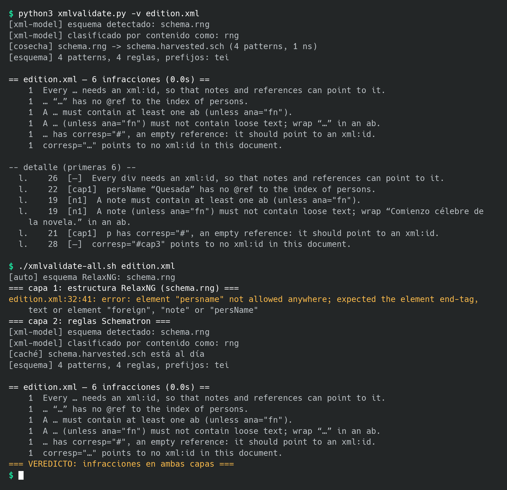

# py-schematron — Validación Schematron de documentos TEI, en el terminal, VS Code y Emacs

*(English: [README.md](README.md))*

**Versión 2.7** (`py-schematron.py --version`, `--about`)

Validador de la capa Schematron del proyecto SMTrad. Extrae las reglas ISO
Schematron embebidas en el ODD (`smed-schema.xml`) y las ejecuta contra uno o
más documentos TEI con Saxon (XPath 3.1), produciendo un informe completo —
sin el tope de visualización de oXygen — con recuento por regla y, en modo
detallado, número de línea y `xml:id` de cada infractor.

- **La línea de órdenes** (`py-schematron.py`) ejecuta las reglas Schematron del
  esquema de un documento (un ODD, un archivo ISO Schematron o un RelaxNG
  con las reglas embebidas), que encuentra por sí sola en el
  `<?xml-model?>` del documento. **`py-schematron-all.py`** añade la capa
  estructural, RelaxNG con jing, y da un solo veredicto para las dos (hasta
  la 2.1 era un script de shell, `py-schematron-all.sh`; ese nombre sigue
  funcionando). Véase [Uso](#3-uso).
- **La extensión de VS Code**
  ([py-schematron-vscode](https://codeberg.org/nivaca/py-schematron-vscode)) muestra los mismos resultados en
  el editor, **mientras se escribe**: los errores subrayados en el texto,
  sus mensajes al pasar el puntero, todos ellos en el panel Problemas
  (Schematron, RelaxNG y buena formación), y el recuento en la barra de
  estado. Está en el [Visual Studio Marketplace](https://marketplace.visualstudio.com/items?itemName=NicolasVaughan.validate-schematron) como *Schematron
  Validator (py-schematron)*. Véase
  [Extensión de VS Code](#32-extensión-de-vs-code).
- **El paquete de Emacs** ([py-schematron.el](https://codeberg.org/nivaca/py-schematron.el), Emacs 31 o
  posterior) hace lo mismo con Flycheck o Flymake: los problemas subrayados
  mientras se escribe, el mensaje del que está bajo el cursor, todos en la
  lista del comprobador, y el completado según el esquema del documento.
  Véase [Paquete de Emacs](#33-paquete-de-emacs).

Los dos complementos tienen repositorio propio; cada uno lleva una copia de
`py-schematron.py`, que se mantiene igual a la de este (§3.4).

Cómo se hizo se cuenta en [`docs/DESCRIPCIÓN_es.md`](docs/DESCRIPCIÓN_es.md).

**Por qué existe.** oXygen presenta tres modos de fallo silencioso
documentados en la historia de este proyecto: el tope de *validation
highlights* (por defecto 100; los errores excedentes se descartan sin aviso),
el *first-match shadowing* entre reglas con contexto idéntico, y las reglas
estructuralmente vacías que invalidan el esquema entero. Este script elimina
el primero por diseño (lista todo, o avisa exactamente cuántos quedan fuera),
y hace visibles los otros dos al dar siempre un recuento total verificable.

## Capturas de pantalla

`py-schematron.py` y `py-schematron-all.py` en el terminal, sobre el ejemplo de
[`docs/example/`](docs/example/) (un texto TEI breve con errores
deliberados, y un esquema RelaxNG pequeño con reglas Schematron embebidas):



La extensión de VS Code (§3.2) sobre el mismo documento: los errores
subrayados, el mensaje de uno de ellos, todos en el panel Problems con la
capa que encontró cada uno (Schematron o RelaxNG), y el recuento en la barra
de estado:


y en un tema claro:


Las capturas las hace [`tools/screenshots.py`](tools/screenshots.py), sin
mostrar nada en pantalla y sin tocar tu configuración; su docstring indica
lo que necesita:

```sh
python3 tools/screenshots.py --python ~/.venvs/schematron/bin/python
```

Las capturas de VS Code usan un clon de
[py-schematron-vscode](https://codeberg.org/nivaca/py-schematron-vscode) junto a
este repositorio (`--extension CARPETA` indica otro).

---

## 1. Requisitos

| Componente | Versión | Papel |
|---|---|---|
| Python | ≥ 3.15 | intérprete |
| [saxonche](https://pypi.org/project/saxonche/) | ≥ 12 | motor XSLT 3.0 / XPath 3.1 (Saxon C) |
| [lxml](https://pypi.org/project/lxml/) | ≥ 4.9 | resolución de números de línea |
| `extract-isosch.xsl` + `common/functions.xsl` | TEI Stylesheets (rama `dev`) | extracción ODD → `.sch` (solo con `-o`) |

El binding XPath 3.1 de Saxon es un superconjunto del motor de oXygen, de
modo que `matches()`, `tokenize()`, `some/every … satisfies`, `if/then/else`
y los `<let>` de las reglas se evalúan de forma idéntica en ambos entornos.

## 2. Instalación

py-schematron se instala de dos maneras:

- **Con el instalador** (§2.1), en Linux, macOS o Windows: una sola orden
  descarga la última versión y prepara todo lo que necesita, en tus
  propias carpetas. Es la manera de usarlo.
- **Desde un clon** del repositorio (§2.2), en Linux o macOS: para trabajar
  en el propio py-schematron o seguir su desarrollo.

### 2.1 Con el instalador (Linux, macOS, Windows)

#### Qué hace falta

Solo **Python 3.15 o posterior**, y conexión a internet mientras se
instala. El instalador no necesita permisos de administrador ni toca el
Python del sistema: crea un entorno de Python propio.

Para saber qué Python tienes, escribe en una terminal `python3 --version`
(Linux, macOS) o, en PowerShell, `py --list` o `python --version`
(Windows). Si es anterior a la 3.15, o no está:

- **Linux:** instálalo con los paquetes del sistema: en Fedora,
  `sudo dnf install python3.15`; en Debian y Ubuntu,
  `sudo apt install python3.15 python3.15-venv` (si tu versión aún no lo
  trae, el [PPA deadsnakes](https://launchpad.net/~deadsnakes/+archive/ubuntu/ppa)
  sí). En Debian y Ubuntu hace falta también `python3.15-venv`.
- **macOS:** descarga el instalador de
  [python.org](https://www.python.org/downloads/macos/) y ábrelo, o usa
  Homebrew: `brew install python@3.15`.
- **Windows:** descarga el instalador de
  [python.org](https://www.python.org/downloads/windows/) y ejecútalo
  (instala también el lanzador `py`, que es lo que busca el instalador), o
  escribe en PowerShell `winget install Python.Python.3.15`.

#### Linux y macOS

Abre una terminal (en macOS: Aplicaciones › Utilidades › Terminal) y
escribe:

```sh
curl -LsSf https://raw.githubusercontent.com/nivaca/py-schematron/main/installers/install.sh | sh
```

Al terminar, dice dónde dejó todo y cómo probarlo:

```sh
py-schematron.py --about
py-schematron.py documento.xml
py-schematron-all.py documento.xml
```

Las órdenes van a `~/bin` si esa carpeta existe y, si no, a
`~/.local/bin`. Si el instalador avisa de que la carpeta no está en tu PATH
(y la terminal responde *command not found*), añádela: en macOS, cuya
terminal usa zsh, agrega la línea `export PATH="$HOME/.local/bin:$PATH"` a
`~/.zshrc`; en Linux, a `~/.profile` o `~/.bashrc`. Luego abre una
terminal nueva.

#### Windows

Abre PowerShell (menú Inicio › escribe *PowerShell*) y escribe:

```powershell
powershell -ExecutionPolicy ByPass -c "irm https://raw.githubusercontent.com/nivaca/py-schematron/main/installers/install.ps1 | iex"
```

El instalador añade la carpeta de sus órdenes a tu PATH. **Cierra
PowerShell y vuelve a abrirlo**, para que lea el PATH nuevo; después:

```powershell
py-schematron --about
py-schematron documento.xml
```

En Windows las órdenes son `py-schematron` y `py-schematron-all`, sin
`.py`. Para la estructura (RelaxNG), `py-schematron-all` usa jing si lo
encuentra y, si no, lxml; véase *jing* más abajo.

`-ExecutionPolicy ByPass` deja correr esa sola orden sin cambiar la
configuración del sistema. Si la política de tu institución prohíbe del
todo los scripts, descarga `py-schematron-v.X.Y.zip` de las
[versiones publicadas](https://github.com/nivaca/py-schematron/releases),
descomprímelo y, en la carpeta que crea, ejecuta
`py installers\install.py --from .`.

#### Qué hace el instalador

1. Busca Python 3.15 o posterior y, si no lo hay, dice dónde conseguirlo.
2. En una carpeta propia, `~/.local/share/py-schematron` (Linux),
   `~/Library/Application Support/py-schematron` (macOS) o
   `%LOCALAPPDATA%\py-schematron` (Windows), pone:
   - `program/`: la última versión de py-schematron, descargada de GitHub
     (o de Codeberg, si GitHub no responde), con las dos hojas de estilo
     de TEI que necesita `-o` (las reglas de un ODD), descargadas de
     [TEIC/Stylesheets](https://github.com/TEIC/Stylesheets);
   - `venv/`: un entorno de Python con saxonche y lxml, instalados con pip.
3. Crea las órdenes, que ejecutan el programa con ese entorno:
   `py-schematron.py` y `py-schematron-all.py` (y `py-schematron-all.sh`,
   su nombre anterior) en `~/bin` o `~/.local/bin` (Linux, macOS), o
   `py-schematron` y `py-schematron-all` en la carpeta `bin\` de su
   carpeta, que añade a tu PATH (Windows).

Una orden del mismo nombre que no creó el instalador, como un enlace hecho
desde un clon con `py-schematron-install.py` (§2.2), se deja intacta; el
instalador lo dice, y `--force` la reemplaza.

#### Actualizar, opciones, desinstalar

Para actualizar a la última versión, vuelve a ejecutar la misma orden; los
esquemas ya descargados se conservan. Para pasarle opciones, ponlas después
de `sh -s --` (Linux, macOS), así:

```sh
curl -LsSf https://raw.githubusercontent.com/nivaca/py-schematron/main/installers/install.sh | sh -s -- --uninstall
```

o, en Windows, descarga `installers\install.ps1` y ejecuta
`powershell -ExecutionPolicy ByPass -File install.ps1 --uninstall`. Con una
copia del repositorio, ejecuta directamente `sh installers/install.sh` o
`installers\install.ps1`. Las opciones son:

| Opción | Efecto |
|---|---|
| `--version X` | Instala la versión X (por ejemplo, `2.0`) en lugar de la última |
| `--from ZIP-O-CARPETA` | Instala desde el zip de una versión, o desde una carpeta (un clon), en lugar de descargar |
| `--no-tei-stylesheets` | No descarga las hojas de estilo de TEI (`-o` necesita entonces `--stylesheets`, §2.2) |
| `--force` | Reemplaza las órdenes del mismo nombre que no creó el instalador |
| `--uninstall` | Quita la carpeta del instalador y sus órdenes (y, en Windows, su entrada del PATH), y nada más |

#### jing (opcional)

`py-schematron.py` comprueba las reglas Schematron. La estructura (RelaxNG)
la comprueba [jing](https://relaxng.org/jclark/jing.html), que usan
`py-schematron-all.py` y los complementos de los editores si está
instalado; sin él, `py-schematron-all.py` usa lxml, más lento en esquemas
grandes. El instalador avisa si falta jing:

- **Linux:** `sudo dnf install jing` (Fedora) o `sudo apt install jing`
  (Debian, Ubuntu).
- **macOS:** `brew install jing-trang`.
- **Windows:** jing necesita Java
  (`winget install EclipseAdoptium.Temurin.21.JRE`) y `jing.jar`, que
  está en el zip de una
  [versión de jing-trang](https://github.com/relaxng/jing-trang/releases);
  luego pon en la variable `JING_JAR` la ruta de ese `jing.jar` (en
  *Configuración › Sistema › Acerca de › Configuración avanzada del sistema
  › Variables de entorno*), y `py-schematron-all` lo ejecuta con Java.

#### Con los complementos de los editores

La [extensión de VS Code](https://codeberg.org/nivaca/py-schematron-vscode)
y el [paquete de Emacs](https://codeberg.org/nivaca/py-schematron.el)
traen su propia copia de py-schematron.py, pero necesitan un Python con
saxonche y lxml. El entorno del instalador los tiene, y los complementos
(la extensión de VS Code desde la 0.11 y el paquete de Emacs desde la 0.9)
usan su Python por sí solos mientras su ajuste de Python esté vacío: basta
con ejecutar el instalador, y no hay nada que configurar. Su Python está
aquí, para versiones anteriores u otros usos:

| Sistema | El Python del instalador |
|---|---|
| Linux | `~/.local/share/py-schematron/venv/bin/python` |
| macOS | `~/Library/Application Support/py-schematron/venv/bin/python` |
| Windows | `%LOCALAPPDATA%\py-schematron\venv\Scripts\python.exe` |

Un Python indicado en el ajuste del complemento (`schematron.pythonPath` en
VS Code, `py-schematron-python` en Emacs) sigue teniendo prioridad.

#### Si algo sale mal

| Lo que ves | Qué hacer |
|---|---|
| *needs Python 3.15 or later, and none was found* | Instálalo (véase *Qué hace falta*), abre una terminal nueva y vuelve a ejecutar el instalador |
| *a Python environment could not be made* (Debian, Ubuntu) | `sudo apt install python3.15-venv`, y vuelve a ejecutarlo |
| *command not found* tras instalar (Linux, macOS) | La carpeta de las órdenes no está en tu PATH: véase *Linux y macOS* más arriba |
| `py-schematron` no se reconoce (Windows) | Cierra PowerShell y vuelve a abrirlo; el PATH se lee al arrancar |
| *running scripts is disabled on this system* (Windows) | Usa la orden exactamente como arriba, con `-ExecutionPolicy ByPass` |
| *the latest release could not be found* | No hay conexión con GitHub ni con Codeberg: descarga el zip de la versión desde otro lugar y usa `--from` |
| *the TEI stylesheets could not be downloaded* | Todo funciona salvo `-o`; vuelve a ejecutar el instalador más tarde, o usa `--stylesheets` (§2.2) |

### 2.2 Desde un clon (Linux, macOS)

```sh
git clone https://codeberg.org/nivaca/py-schematron.git    # o https://github.com/nivaca/py-schematron.git
cd py-schematron
```

```sh
# 1. Dependencias Python
pip install saxonche lxml

# 2. Hojas de estilo TEI (solo necesarias para la extracción con -o), si
#    no tienes un clon de TEIC/Stylesheets (véase abajo). Debe respetarse la
#    estructura de carpetas, porque extract-isosch.xsl importa
#    ../common/functions.xsl:
mkdir -p odds common
curl -sL -o odds/extract-isosch.xsl \
  https://raw.githubusercontent.com/TEIC/Stylesheets/dev/odds/extract-isosch.xsl
curl -sL -o common/functions.xsl \
  https://raw.githubusercontent.com/TEIC/Stylesheets/dev/common/functions.xsl
```

Disposición resultante:

```
py-schematron/
├── py-schematron.py
├── py-schematron-all.py
├── py-schematron-all.sh        (el nombre anterior de py-schematron-all.py)
├── py-schematron-install.py
├── odds/
│   └── extract-isosch.xsl
└── common/
    └── functions.xsl
```

Las rutas a `odds/` y `common/` se resuelven relativas al script
(`Path(__file__).parent`), no al directorio de trabajo: puedes invocarlo
desde cualquier sitio.

Si ya tienes las TEI Stylesheets (un clon de
[TEIC/Stylesheets](https://github.com/TEIC/Stylesheets), o la copia de
oXygen), `-o` puede usarlas en lugar de copias junto al script. Busca, en
este orden, en `--stylesheets CARPETA`, la variable de entorno
`TEI_STYLESHEETS`, el ajuste `stylesheets` del archivo de configuración de
[ODD2RNG](https://codeberg.org/nivaca/ODD2RNG)
(`~/.config/odd2rng/config.toml`) y, por último, en `odds/` y `common/`
junto al script. `py-schematron.py --about` dice qué carpeta usa.

#### Las órdenes en `~/bin`


Para llamar a los scripts por su nombre desde cualquier carpeta, enlázalos
en `~/bin`:

```sh
python3 py-schematron-install.py
```

Crea enlaces simbólicos, `~/bin/py-schematron.py` y
`~/bin/py-schematron-all.py` (y `~/bin/py-schematron-all.sh`, su nombre
anterior), que apuntan a esta carpeta; así un `git pull`
aquí actualiza las órdenes de inmediato. Si mueves la carpeta, vuelve a
ejecutarlo. Un archivo u otro enlace con el mismo nombre no se toca
(`--force` reemplaza otro enlace, nunca un archivo); `--uninstall` quita
solo sus propios enlaces, y `--bin CARPETA` los pone en otro sitio.

Las órdenes corren con el primer `python3` del PATH, que necesita saxonche
y lxml. El instalador lo comprueba y, si faltan, muestra la orden que los
instala (`python3 -m pip install --user saxonche lxml`). También sirve un
entorno virtual, si su carpeta `bin/` va primero en el PATH.

### 2.3 Pruebas

```sh
python3 tools/test.py
```

ejecuta las pruebas a la vez, cada archivo en un proceso propio, tantos a
la vez como procesadores haya (`-j N` lo cambia; `-v` muestra cada
archivo a medida que termina); `python3 -m unittest discover -s tests -v`
las corre una tras otra. En los dos casos son las pruebas de
`py-schematron.py`, `py-schematron-all.py` y `py-schematron-install.py`
(`tests/test_py_schematron.py`), con el Python que las corre, que
necesita saxonche y lxml; no hace falta nada más.
Escriben documentos y esquemas pequeños para cada caso en una carpeta
temporal, con su propia copia de los scripts, de modo que nada queda en
esta: reglas y mensajes, el *first-match shadowing*, los `let` de todos los
niveles y `current()`, las reglas rotas y los códigos de salida, los
documentos mal formados, las fuentes de las reglas (`-s`, `-r`,
`<?xml-model?>`, `--as`), el caché, un esquema remoto servido por un pequeño
servidor web local, con `--refresh`, el informe de texto y el instalador. La
pruebas del ODD necesitan las hojas de estilo de TEI en `odds/` y `common/`, y
las de `py-schematron-all.py` necesitan jing; sin ellas se omiten. Las pruebas no leen tu propia `TEI_STYLESHEETS` ni la configuración de
ODD2RNG.

`tests/test_installers.py` prueba el instalador de §2.1 sin red ni pip:
las carpetas de cada sistema, las órdenes que escribe, una actualización
que conserva el caché, una orden que no creó él y la desinstalación.

Las pruebas usan documentos pequeños; los reales se comprueban con

```sh
python3 tools/corpus-check.py --corpus ~/ediciones     # o con PY_SCHEMATRON_CORPUS
```

que valida cada documento con `<?xml-model?>` de la carpeta con dos
versiones del programa, la última publicada (o `--against ETIQUETA`, o
`--old ARCHIVO`) y la de esta carpeta, y lista los documentos cuyo
resultado cambió: las infracciones, las reglas que no se pudieron evaluar,
un documento mal formado, el código de salida. Da también el tiempo total
de cada versión, y avisa de cualquier documento que la versión nueva valide
claramente más despacio (más de un 50 % y de un cuarto de segundo;
`--slower` y `--min-seconds` lo cambian), después de medirlo otra vez a
solas. Los documentos se copian a una carpeta temporal y se
validan allí (con `--as`, para que sus referencias relativas al esquema
sigan funcionando); los originales solo se leen. Sus propias pruebas están
en `tests/test_corpus_check.py`.

En GitHub las pruebas corren en cada *push* y cada lunes
(`.github/workflows/tests.yml`), con jing y las dos hojas de estilo, de
modo que ninguna se salta, después de una revisión estática del código en
Python con [ruff](https://docs.astral.sh/ruff/) (sus reglas están en
`ruff.toml`: errores como nombres sin definir o importaciones sin usar, no
el estilo; aquí se ejecuta con `ruff check .`). Otra tarea instala py-schematron de verdad con
`installers/` en Linux y Windows, como lo haría un usuario, y luego
ejecuta la orden, valida un documento y lo desinstala; también en macOS
para las etiquetas de cada versión, la corrida de los lunes y las que se
lanzan a mano, porque GitHub a menudo no tiene un Mac libre.

## 3. Uso

```
python3 py-schematron.py [-o ODD | -s SCH | -r RNG] [-v] [--max N] [--refresh] [--json] [--as RUTA] DOC.xml [...]
```

Desde la v1.2, los flags de esquema son **opcionales**: sin ellos, el
esquema se **autodetecta** de las PIs `<?xml-model?>` del primer documento
(§3.1).

| Opción | Efecto |
|---|---|
| `-o, --odd RUTA` | Extrae el `.sch` de un ODD **con Schematron embebido** (con caché, §4) y valida con él. Un ODD sin reglas embebidas (p. ej. `tei_all.odd` sin compilar) se rechaza con aviso, no se valida en vacío (§7) |
| `-s, --sch RUTA` | Usa un `.sch` ya extraído; omite la extracción |
| `-r, --rng RUTA` | **Cosecha** las anotaciones `sch:ns`/`sch:pattern` embebidas en un RelaxNG generado de ODD (deduplicadas, con caché) y valida con ellas — las mismas reglas que Jing ignora |
| `-v, --verbose` | Listado detallado: línea, `xml:id`, mensaje por infractor |
| `--max N` | Máximo de infractores en el detalle (defecto 50). Si hay más, el script **dice cuántos quedaron fuera** — nunca trunca en silencio |

| `--jobs N` | Con varios documentos: validar N a la vez, en procesos aparte (`0`: tantos como procesadores); el informe sale en el orden de siempre |
| `--refresh` | Con autodetección: volver a descargar un esquema remoto aunque esté en caché |
| `--json` | Informe legible por máquina en stdout: todas las infracciones (pattern, contexto, assert/report, `role`, mensaje, texto interpolado, `fn:path`, línea, `xml:id`), errores XPath por regla y la fuente del esquema; ignora `-v`/`--max`. Un documento mal formado se convierte en una entrada `error` en lugar de abortar la corrida. Los mensajes de progreso siguen yendo a stderr y, desde la 1.21, también están en `events`, un objeto por mensaje, con un `kind` estable (`xml-model`, `download`, `cache`, `extraction`, `harvest`, `schema`, `warning`), el mensaje y sus datos (`url`, `file`, `patterns`…). Un error fatal (código 3) también da JSON: `{"version", "error", "events"}`. Los complementos leen esto, no stderr. Desde la 1.21 cada infracción y cada error XPath tiene además `rule`, `{"file", "line"}` de su assert o report: en el ODD o el RelaxNG de donde viene, con `-o`, `-r` o la autodetección (el archivo que se edita), no en el `.sch` que se hace a partir de ellos; los complementos lo usan para saltar a la regla |
| `--as RUTA` | Con un único documento: tratarlo como si estuviera en RUTA, para resolver los hrefs relativos de `xml-model` y para el nombre en el informe. La extensión de VS Code lo usa para validar el texto sin guardar a partir de una copia temporal |
| `--stylesheets CARPETA` | Las TEI Stylesheets para `-o`, en lugar de `TEI_STYLESHEETS`, la configuración de ODD2RNG u `odds/` junto al script (§2) |
| `--about` | Qué es este programa, quién lo hizo, su licencia y dónde está, y con qué corre aquí: Python, saxonche, lxml, Saxon, la carpeta del caché y si están las hojas de estilo de TEI para `-o`. Con `--version`, las únicas opciones que no necesitan documento |

Las tres fuentes explícitas son mutuamente excluyentes; si no se da ninguna,
opera la autodetección.

### 3.1 Autodetección por `<?xml-model?>` (v1.2)

Sin `-o/-s/-r`, el script lee las PIs `xml-model` del primer documento y:

1. **Elige el href**: preferentemente el de `schematypens` Schematron; en su
   defecto, el de RelaxNG (se cosechará su Schematron embebido). El patrón
   habitual — el mismo `.rng` asociado dos veces, una por capa — converge en
   una sola fuente.
2. **Resuelve la ruta**: relativa *al documento* (no al directorio de
   trabajo), absoluta, o URL http(s) — que se descarga a `.schema-cache/`
   junto al script (nombre = hash de la URL + nombre original) y se reutiliza
   en corridas siguientes; `--refresh` fuerza la redescarga. Nota: a
   diferencia del caché por mtime, el de URL no detecta actualizaciones
   remotas — tras una release nueva del esquema, usa `--refresh`.
3. **Clasifica por contenido real**, no por extensión ni por lo declarado:
   raíz RelaxNG → cosecha; raíz ISO Schematron → uso directo; raíz TEI
   (ODD) → extracción. Con varios documentos, el esquema se detecta del
   primero (con aviso). Sin ninguna PI y sin flags: código 3 con mensaje.

Con ello, la invocación mínima es simplemente:

```sh
python3 py-schematron.py documento.xml
```

### Recetas

```sh
# Ciclo cotidiano: extraer si hace falta y validar
python3 py-schematron.py -o ../smed-schema/smed-schema.xml ../salmarc_ed_lat.xml

# Informe completo para la campaña de corrección
python3 py-schematron.py -o ../smed-schema/smed-schema.xml -v --max 999 \
    ../salmarc_ed_lat.xml > pendientes.txt

# Varios documentos contra un .sch fijo
python3 py-schematron.py -s smed-schema.sch -v ed_lat.xml ed_es.xml

# Contra el Schematron de las Guidelines, cosechado del RNG de tei_all (§7)
python3 py-schematron.py -r tei_all.rng -v documento.xml

# Un solo artefacto para las dos capas: estructura con Jing, reglas con -r
jing smed-schema.rng ed_lat.xml && python3 py-schematron.py -r smed-schema.rng ed_lat.xml

# O con el wrapper bicapa (ejecuta ambas capas SIEMPRE, sin cortocircuito,
# con veredicto compuesto: 0 limpio, 1 RelaxNG, 2 Schematron, 3 ambas,
# 4 entorno o capa Schematron incompleta;
# si jing no está instalado usa el RelaxNG de lxml como respaldo):
./py-schematron-all.py -v smed-schema.rng ed_lat.xml

# Wrapper en modo auto (v1.2): sin esquema, lo detecta de la PI xml-model
# del documento (clasificando el primer argumento por contenido, no por
# extensión) y comparte el caché de descargas de py-schematron.py:
./py-schematron-all.py -v documento.xml

# En un Makefile o hook pre-commit (código de salida ≠ 0 si hay infracciones)
python3 py-schematron.py -s smed-schema.sch ed_lat.xml || echo "hay pendientes"
```

### Códigos de salida

| Código | Significado |
|---|---|
| 0 | sin infracciones |
| 1 | una o más infracciones |
| 2 | error de invocación (argparse) |
| 3 | la validación no pudo completarse: un documento mal formado, una regla que no se pudo evaluar (un error XPath; el informe la lista, y las demás reglas se comprueban igual) o un error de entorno (archivo inexistente, XSLT ausente, ODD/RNG sin reglas), con mensaje por stderr |

### 3.2 Extensión de VS Code

La extensión para Visual Studio Code tiene su propio repositorio,
[py-schematron-vscode](https://codeberg.org/nivaca/py-schematron-vscode) (también en
[GitHub](https://github.com/nivaca/py-schematron-vscode)), y está en el
[Visual Studio Marketplace](https://marketplace.visualstudio.com/items?itemName=NicolasVaughan.validate-schematron) como *Schematron Validator
(py-schematron)*. Ejecuta su copia de `py-schematron.py --json`, y jing
cuando el esquema es RelaxNG, y muestra los resultados como diagnósticos en
el editor y en el panel Problemas:

- **Cuándo:** mientras se escribe (cuando la escritura se detiene medio
  segundo, un ajuste), al abrir y al guardar, en cada archivo `.xml` con un
  `<?xml-model?>`. El texto sin guardar se valida a partir de una copia
  temporal privada; tu archivo nunca se escribe.
- **Qué se ve:** cada error subrayado, con su mensaje al pasar el puntero y
  su capa (**Schematron**, **RelaxNG**, o **XML** cuando el documento no
  está bien formado); un elemento mal escrito se marca donde se abrió. La
  barra de estado muestra el resultado del archivo actual: una marca cuando
  está limpio, el número de problemas, o "failed" cuando la validación no
  pudo ejecutarse.
- **Órdenes** (Ctrl+Shift+P, "Schematron"): *Validate Current File*,
  *Refresh Schema* (volver a descargar un esquema remoto que cambió),
  *Select Python Interpreter…*, *Show Output* y *Clear Diagnostics*.

**Instalación:** desde la vista de extensiones (busca "Schematron
Validator"), o con el `.vsix` de una versión publicada de
py-schematron-vscode y `code --install-extension validate-schematron-*.vsix`.
Luego indica en `schematron.pythonPath` un Python que tenga saxonche y lxml
(la extensión ofrece elegirlo si hace falta). Ajustes, requisitos, cómo
compilarla y otros detalles en su
[README](https://codeberg.org/nivaca/py-schematron-vscode#schematron-validator-for-vs-code) (en inglés).

### 3.3 Paquete de Emacs

El paquete de Emacs tiene su propio repositorio,
[py-schematron.el](https://codeberg.org/nivaca/py-schematron.el) (también en
[GitHub](https://github.com/nivaca/py-schematron.el)). Es un comprobador
de Flycheck y un backend de Flymake para Emacs 31 o posterior, y usa
Flycheck cuando está instalado. Ejecuta su copia de `py-schematron.py
--json` igual que la extensión de VS Code, con jing para los esquemas
RelaxNG, y muestra los resultados en el búfer: cada problema subrayado, su
mensaje cuando el cursor está encima, con su capa (Schematron, RelaxNG o
XML) y su pattern, y todos en la lista del comprobador. En nxml-mode le da
además a nxml el esquema RelaxNG del documento (convertido con trang), de
modo que `C-RET` completa los elementos y atributos que el esquema permite.
Comprueba mientras se escribe, a partir de una copia temporal privada, y una
comprobación nueva cancela la que sigue en marcha.

**Instalación**, con Straight:

```elisp
(use-package py-schematron
  :straight (:host codeberg :repo "nivaca/py-schematron.el")
  :hook (nxml-mode . py-schematron-mode))
(setopt trusted-content '("~/ruta/a/tus/ediciones/"))
```

o con package-vc, `(package-vc-install '(py-schematron :url
"https://codeberg.org/nivaca/py-schematron.el"))`. Flymake solo comprueba los archivos de
`trusted-content`, y el paquete respeta esa regla también con Flycheck:
Saxon ejecuta el esquema que nombra el documento, y su XPath puede leer
archivos y pedir URL. Hasta la versión 0.2.0 el paquete estaba en la
carpeta `emacs/` de este repositorio; las recetas que apuntan aquí (con
`:lisp-dir "emacs"` o `:files ("emacs/*.el")`) deben cambiarse por la de
arriba. La configuración, las órdenes, trang y las pruebas están en su
[README](https://codeberg.org/nivaca/py-schematron.el#py-schematron-for-emacs) (en inglés).

### 3.4 Las copias de py-schematron.py en los complementos

Cada complemento lleva su propia copia de `py-schematron.py`, en la raíz de
su repositorio, para poder instalarse solo. Después de cambiar el script
aquí,

```sh
python3 tools/sync-plugins.py           # la copia en ../py-schematron.el y ../py-schematron-vscode
python3 tools/sync-plugins.py --check   # solo dice si las copias son iguales (sale con 1 si no)
```

la copia en los clones de los dos complementos que están junto a este
repositorio (`--emacs CARPETA` y `--vscode CARPETA` indican otros) y dice qué
copias cambiaron y desde qué versión. No hace commits: la copia se guarda y
se publica después en cada complemento, cuyo registro de cambios dice qué
versión lleva. También copia `tools/release.py`, el script de publicación que
comparten los tres repositorios (ODD2RNG también lo usa, con una copia
hecha a mano).

### 3.5 Publicar una versión

```sh
python3 tools/release.py --dry-run   # comprueba, prueba y construye; dice qué seguiría
python3 tools/release.py             # luego etiqueta, sube y publica
```

publica la versión de `py-schematron.py`, con las notas de su fila en el
historial de versiones (§11) o las de `--notes ARCHIVO`. Comprueba que todo
esté guardado en git y que la etiqueta sea nueva, corre las pruebas, hace el
zip (`tools/bundle-zip.py`), etiqueta el commit, sube `main` y la etiqueta a
Codeberg y a GitHub, crea la versión en ambos (con `tea` y `gh`), adjunta el
zip y lo descarga de ambos para compararlo con el local. Un paso ya hecho se
salta, así que tras un fallo basta con volver a correrlo. Si
`PY_SCHEMATRON_CORPUS` indica tus documentos, corre además la comprobación
del corpus (§2.3) después de las pruebas, y se detiene si algún resultado
cambió; `--accept-corpus-changes` lo deja seguir cuando el cambio es
buscado. En cada
complemento el mismo script publica el complemento, con las notas de su
registro de cambios, y antes comprueba que su copia de `py-schematron.py`
sea igual a esta.

## 4. Configuración y caché

- **Caché de extracción**: con `-o`, el `.sch` se escribe junto al ODD
  (mismo nombre, extensión `.sch`); con `-r`, junto al RNG (extensión
  `.harvested.sch`). Solo se regeneran si el mtime de la fuente **o del propio
  script** es posterior — actualizar `py-schematron.py` invalida automáticamente
  todos los derivados, de modo que un generador corregido nunca convive con
  derivados producidos por la versión defectuosa. El mensaje `[caché] ... está al día` lo indica. Para forzar la
  regeneración: `touch` a la fuente o borrar el derivado.
- **Prefijos de namespace**: se leen de los `<ns>` del propio `.sch`
  (actualmente solo `tei:`). No hay nada que configurar a mano.
- **Sin archivo de configuración**: todo el estado observable está en la
  línea de órdenes y en los dos artefactos (ODD, `.sch`).

## 5. Funcionamiento interno

### Pipeline

1. **Extracción** (solo `-o`): Saxon aplica `extract-isosch.xsl` al ODD y
   produce el ISO Schematron con `queryBinding="xslt2"` — un `pattern` por
   `constraintSpec`, como hace la cadena TEI estándar.
2. **Carga de reglas**: lxml parsea el `.sch` y construye la lista de
   patterns → reglas → (`context`, `let*`, tests `assert`/`report`).
3. **Ejecución**: para cada regla, los nodos de contexto se localizan con
   Saxon (`//(contexto)` para contextos relativos; los absolutos tal cual) y
   cada test se evalúa como *effective boolean value* en XPath 3.1. Los
   `<let>` se traducen a la expresión nativa `let $x := (...) return (...)`.
4. **Self-check de cosecha** (solo `-r`): el `.harvested.sch` recién
   escrito se re-parsea y sus recuentos se comparan con lo cosechado; si
   difieren (corrupción en la serialización), el script termina con código 3
   en lugar de validar contra un esquema mutilado.
5. **Informe**: recuento agregado por mensaje de regla; con `-v`, cada
   infractor se resuelve a línea física y `xml:id` mediante `fn:path()`
   (Saxon) → conversión de la notación `Q{uri}` a prefijos → localización
   del nodo con lxml (`sourceline` + primer ancestro con `@xml:id`).

### Semántica ISO Schematron implementada

Cubierto — el subconjunto exacto que usa el ODD smed:

- `pattern`, `rule`, `assert`, `report`, `let`. Un `let` de schema o de
  pattern se evalúa con la raíz del documento como contexto, y el de una
  regla con el nodo de la regla, como dice el estándar (antes de la 1.18
  todos tomaban el nodo de la regla); las variables de pattern pueden usarse
  también en el contexto de la regla;
- `current()` (función XSLT usada por las reglas de las Guidelines P5): se
  traduce a una ligadura del nodo de contexto (`let $VALIDATE_CTX := .`) con
  sustitución textual, que reproduce exactamente su semántica Schematron;
- **first-match shadowing dentro de cada pattern**: un nodo casado por una
  regla anterior del mismo pattern queda excluido de las siguientes,
  conforme al estándar. (La extracción TEI emite un pattern por
  constraintSpec, de modo que el shadowing *entre* constraintSpecs es
  imposible por construcción — el runner lo honra igualmente por fidelidad.)

No implementado — el script **avisa por stderr una vez por tipo** y
continúa: `phase` (se ejecutan todos los patterns), patterns/reglas
abstractos (se omiten), `diagnostics`, `xsl:key`, y elementos
de otros espacios de nombres como `sqf:fix` (Quick Fixes de oXygen, que no
afectan a los veredictos). Con el ODD smed nada de esto aparece; con
Schematron de las Guidelines (§7) verás el aviso de `sqf`.

### Rendimiento

Un documento pequeño se comprueba en una décima de segundo. Arrancar el
script apenas cuesta (Python con saxonche y lxml carga en unos 15 ms): el
tiempo se va en evaluar las reglas, y dos cambios lo redujeron mucho en los
documentos grandes. En la edición latina, `salmarc_ed_lat.xml` (unas 26 000
líneas y 2000 elementos `<app>`), la versión 1.15 bajó la comprobación de
13,9 s a 3,5 s, y la 1.16 la hizo unas seis veces más rápida todavía:
medidas una tras otra en la misma máquina (ocupada), 11,5 s con la 1.15 y
1,9 s con la 1.16. Los resultados fueron idénticos en 39 documentos.

Desde la versión 1.15, todos los tests de una regla se evalúan juntos, en
una sola llamada por nodo, de modo que las variables `<let>` de la regla se
calculan una vez por nodo, como quiere ISO Schematron; antes, cada test las
volvía a calcular. En el esquema smed, cuya regla de `<app>` tiene siete
tests que comparten siete variables costosas, la edición latina pasó de
13,9 s a 3,5 s, con los mismos resultados. Si la llamada conjunta falla, los
tests de la regla se evalúan uno a uno, y un test roto se sigue informando
por separado.

Desde la versión 1.16, cada regla se evalúa en una sola llamada para todos
sus nodos de contexto, y no en una llamada por nodo. Saxon compila cada
expresión que recibe, así que llamarlo nodo a nodo compilaba la expresión de
la regla miles de veces; en la regla de `<app>`, esa compilación se llevaba
9 de los 9,6 s. La llamada única devuelve, por cada nodo, su `path()` (para
el *first-match shadowing*) y el resultado de cada test; solo las
infracciones vuelven a Saxon, para completar sus mensajes. Los nodos que una
regla anterior tapa se evalúan también, y sus resultados se descartan. Si la
llamada única falla (por ejemplo, un test que lanza un error), la regla se
evalúa nodo a nodo como antes: los nodos tapados se saltan y un test roto se
informa por separado.

Lo que queda es el trabajo propio de las variables, como los barridos
`//*[@xml:id = ...]`; si algún día pesaran, la alternativa documentada en el
ODD es `id()` sobre motor Saxon.

## 6. Interpretación de la salida

```
[caché] smed-schema.sch está al día
[esquema] 28 patterns, 28 reglas, prefijos: tei

== salmarc_ed_lat.xml — 250 infracciones (0.8s) ==
  219  Empty lem must have a corresp attribute.
   30  An empty lem must be followed by an rdg with @type="variation-present".
    1  Every pointer in the corresp attribute of this empty lem must be ...

-- detalle (primeras 300) --
  l.  2637  [o5h_cfj_2cc]  An empty lem must be followed by an rdg with ...
```

- Las líneas `[...]` van por **stderr** (diagnóstico del propio script); el
  informe va por **stdout** — la redirección `> pendientes.txt` captura solo
  el informe.
- En el detalle, el `xml:id` es el del **ancestro identificable más
  cercano** al nodo infractor (típicamente el `<app>`), y la línea es la del
  nodo infractor mismo en el archivo fuente.
- La cifra total del encabezado es siempre exacta; `--max` limita solo el
  listado, nunca el recuento.

## 7. Validar contra un ODD estándar (tei_all y compañía)

Un ODD de personalización estándar como `tei_all.odd` es un manifiesto de
`moduleRef`s: sus reglas Schematron viven en las fuentes de las Guidelines
(`p5subset.xml`), no en el archivo. Por eso `-o` lo **rechaza** con código 3
en lugar de validar contra un esquema vacío que daría por bueno cualquier
documento. Dos rutas:

- **Ruta canónica**: compilar el ODD contra `p5subset.xml` con `odd2odd.xsl`
  (cadena TEI completa; exige clonar el repositorio de Stylesheets) y pasar
  el ODD compilado a `-o`.
- **Ruta pragmática (recomendada)**: `-r tei_all.rng`. El RelaxNG que
  distribuyen TEI y oXygen (`frameworks/tei/xml/tei/custom/schema/relaxng/`)
  lleva embebidas exactamente las mismas reglas; el script las cosecha,
  deduplica y ejecuta. Recuerda que con un esquema estándar la proporción se
  invierte respecto a smed: el grueso de la validación es la capa RelaxNG
  (Jing) y el Schematron de P5 aporta solo unas decenas de co-restricciones
  — aquí el runner es el complemento, no el plato principal.

**De dónde obtener `tei_all.rng`** (no lo generes: se distribuye compilado,
con el Schematron de las Guidelines embebido):

```sh
# release oficial de TEI (la más reciente):
curl -sLO https://www.tei-c.org/release/xml/tei/custom/schema/relaxng/tei_all.rng
# o el que trae tu oXygen (misma versión de P5 que tu editor):
#   $OXYGEN_HOME/frameworks/tei/xml/tei/custom/schema/relaxng/tei_all.rng
```

Elige **una** fuente y úsala para ambas capas: mezclar el `.rng` de oXygen
en Jing con el de tei-c.org en el runner (o viceversa) puede producir
discrepancias entre capas por diferencia de versión de P5.

**Receta bicapa completa contra el estándar:**

```sh
jing tei_all.rng documento.xml && python3 py-schematron.py -r tei_all.rng documento.xml
```

El `&&` corta en la primera capa que falle; tras el runner, `$? -eq 1`
significa inequívocamente "infracciones Schematron" (no error de entorno,
que es 3). La primera corrida cosecha a `tei_all.harvested.sch` (muchos más
patterns que un esquema de proyecto: tei_all incluye todos los módulos);
las siguientes usan el caché.

Nota sobre recuentos: el `.rng` generado de un ODD embebe, además de las
reglas propias, el Schematron de las Guidelines para cada módulo incluido
(p. ej. "Abstract model violation: Lines may not contain hi", regla P5
sobre `tei:l`). La ruta `-r` valida por tanto un **superconjunto** de la
ruta `-o` — más patterns, y potencialmente infracciones nuevas que oXygen
también reportaría. Los patterns cosechados que quedan sin reglas
utilizables (vacíos o abstractos) se descartan, de ahí que la cifra de
`[esquema]` pueda ser menor que la de `[cosecha]`.

La ruta `-r` funciona igualmente con el `.rng` **propio**: un único
artefacto alimenta entonces ambas capas (estructura con Jing, reglas con el
runner), eliminando el riesgo de divergencia entre un `.rng` y un `.sch`
regenerados asimétricamente.

## 8. Qué NO valida este script

La **capa estructural RelaxNG** (modelos de contenido, atributos permitidos)
es competencia del `.rng` generado del mismo ODD. Desde terminal:

```sh
jing smed-schema.rng salmarc_ed_lat.xml     # apt install jing / brew install jing
```

Jing ignora el Schematron embebido en el RNG — exactamente el hueco que este
script cubre. Las dos órdenes juntas replican la validación completa de
oXygen, sin topes y con salida procesable.

## 9. Problemas conocidos y resolución

| Síntoma | Causa | Remedio |
|---|---|---|
| `OSError: failed to load external entity "X.xml"` | El documento no existe en la ruta dada (mensaje críptico de lxml) | Verificar ruta; las versiones recientes del script lo comprueban antes (`No existe el documento: /ruta/absoluta`) |
| `No encuentro .../odds/extract-isosch.xsl` | Faltan las hojas TEI o la estructura de carpetas | Repetir §2, respetando `odds/` y `common/` junto al script |
| `XTSE0165 ... functions.xsl` | `extract-isosch.xsl` presente pero `common/functions.xsl` ausente | Descargar la segunda hoja |
| `[ERROR XPath] regla '...'` | Un test del `.sch` no compila/evalúa en XPath 3.1 | Revisar esa regla en el ODD; el resto de reglas sigue ejecutándose |
| `[aviso] elemento Schematron no implementado: X` | El `.sch` usa constructos fuera del subconjunto (§5) | Ampliar el runner o reformular la regla |
| El `.sch` no refleja un cambio reciente del ODD/RNG | Caché por mtime con reloj/copias raras (Dropbox) | `touch` a la fuente o borrar el derivado (`.sch` / `.harvested.sch`) |
| `El ODD X no contiene Schematron embebido` (código 3) | ODD de personalización sin compilar (p. ej. `tei_all.odd`) | Usar `-r` sobre su RNG generado, o compilar con `odd2odd` (§7). Saxon imprime antes su propio error `XTMM9000`: es el mismo diagnóstico en crudo |
| `El RelaxNG X no contiene anotaciones Schematron` (código 3) | RNG generado sin reglas embebidas | Regenerarlo desde el ODD con la cadena estándar, o usar `-o`/`-s` |
| `[aviso] elementos ajenos a Schematron ignorados (p. ej. fix ...)` | Schematron de las Guidelines (§7) | Informativo; los veredictos no se ven afectados |
| `[aviso] elementos ajenos a Schematron ignorados (p. ej. ... de http://www.tei-c.org/ns/1.0)` con versiones del script anteriores a 2026-07-12, o `Self-check de cosecha fallido` | Bug histórico de la cosechadora: lxml serializaba con declaraciones de namespace rancias y el `.harvested.sch` quedaba corrupto (patterns/reglas perdidos, prefijos vacíos, `Namespace prefix 'tei' has not been declared`) | Actualizar el script (≥ 2026-07-12, con `cleanup_namespaces` + self-check) y borrar los `.harvested.sch` existentes; el caché por doble mtime lo hace automáticamente en adelante |
| Recuentos distintos de los de oXygen | Tope de highlights de oXygen, o `.rng` desactualizado en oXygen | Subir el tope (Options → Preferences → Editor → Document Checking) y regenerar el `.rng`; la cifra del script es la exacta |

## 10. Historial de diseño

Decisiones que conviene no re-litigar sin releer la historia del proyecto:

- **Runner propio en vez de implementación empaquetada**: `pyschematron`
  (XPath 2.0 en Python puro) tarda minutos en este corpus por los barridos
  `//*[@xml:id=…]`; Jing no soporta `queryBinding="xslt2"`; SchXslt exige
  gestionar artefactos XSLT adicionales. Saxon vía `saxonche` ya era
  dependencia del proyecto y da velocidad C con el binding correcto.
- **Sin tope oculto**: el defecto `--max 50` limita el *detalle*, pero el
  script declara siempre el total y cuántos quedaron sin listar — respuesta
  directa al episodio del tope de oXygen (julio 2026).
- **Rechazo de esquemas vacíos**: un ODD o RNG sin reglas termina con
  código 3 en vez de "validar" en vacío — cierre del cuarto modo de fallo
  silencioso posible (esquema sin contenido que aprueba todo).
- **Un pattern por constraintSpec**: heredado de la extracción TEI; hace
  estructuralmente imposible el shadowing entre constraintSpecs que afectó
  a versiones antiguas del esquema.

## 11. Version history

| Versión | Fecha | Cambios |
|---|---|---|
| **2.7** | 2026-11-21 | `docs/THIRD-PARTY.md` y `docs/THIRD-PARTY_es.md`: el software libre que usa el programa, y la licencia de cada uno, desde aquello con lo que corre (Python, saxonche, lxml, jing, las TEI Stylesheets) hasta las herramientas con que se desarrolla y se prueba. Las descripciones están al día con la 2.6. La validación es la misma |
| 2.6 | 2026-11-19 | **`--jobs N`**: con varios documentos, validar N a la vez en procesos aparte, cada uno con su propio Saxon y las reglas ya leídas (`0`: uno por procesador); los resultados y el informe son los mismos, en el mismo orden. Sobre 32 ediciones, 0,28 s en lugar de 0,65 s con ocho. 56 pruebas. La validación es la misma |
| 2.5 | 2026-11-19 | El código en Python se revisa con ruff en GitHub antes de las pruebas (`ruff.toml`: errores reales, no el estilo); las seis cosas que encontró, todas menores (lambdas con nombre, dos variables llamadas `l`), quedan corregidas. La validación es la misma |
| 2.4 | 2026-11-19 | `tools/corpus-check.py` compara también el tiempo de cada documento, y avisa de los que la versión nueva valida claramente más despacio (más de un 50 % y de 0,25 s, confirmado midiéndolos otra vez a solas), para ver una lentitud antes de publicar. 54 pruebas. La validación es la misma |
| 2.3 | 2026-11-19 | Se quitan `pyproject.toml` y `src/py_schematron/`, un andamiaje de paquete que nunca se usó (su orden `py-schematron` solo imprimía un saludo): el programa son sus scripts, que se instalan con `installers/` o desde un clon (§2). La validación es la misma |
| 2.2 | 2026-11-19 | **`py-schematron-all.py`**: las dos capas son ahora un programa en Python, así que funcionan también en Windows (los instaladores crean allí `py-schematron-all`); donde no hay orden `jing`, ejecuta con Java el `jing.jar` que indique `JING_JAR` y, si no, usa lxml. `py-schematron-all.sh`, su nombre anterior, sigue funcionando. **`tools/corpus-check.py`** compara la última versión publicada con esta sobre cada documento de un corpus (`--corpus`, `PY_SCHEMATRON_CORPUS`), y `tools/release.py` la ejecuta antes de publicar. 53 pruebas. La validación es la misma |
| 2.1 | 2026-11-19 | **Instaladores para Linux, macOS y Windows** (`installers/`, §2.1): una orden descarga la última versión y la instala en las carpetas del usuario, con un entorno de Python propio (saxonche, lxml), las dos hojas de estilo de TEI para `-o` y las órdenes en el PATH; vuelto a ejecutar, actualiza, y `--uninstall` lo quita. Instrucciones detalladas para cada sistema, en inglés y en español. `py-schematron-all.sh` toma su Python de `PY_SCHEMATRON_PYTHON`. 45 pruebas; GitHub, además, lo instala de verdad en los tres sistemas. La extensión de VS Code (0.11) y el paquete de Emacs (0.9) usan por sí solos el Python del instalador. La validación es la misma |
| 2.0 | 2026-11-19 | **El proyecto pasa a llamarse py-schematron** (era py-xmlvalidate): los scripts son `py-schematron.py`, `py-schematron-all.sh` y `py-schematron-install.py`; los repositorios, nivaca/py-schematron, nivaca/py-schematron.el (el paquete de Emacs) y nivaca/py-schematron-vscode (la extensión de VS Code, cuyo nombre no cambia), y el zip de cada versión, `py-schematron-v.X.Y.zip`. Las direcciones antiguas de los repositorios redirigen a las nuevas. Hay que ejecutar de nuevo `py-schematron-install.py`, que enlaza los nombres nuevos en `~/bin` y quita los enlaces antiguos. La validación es la misma |
| 1.21 | 2026-11-19 | Con `--json`, los mensajes de progreso son también `events` del informe (descarga, caché, extracción, cosecha…), con tipos estables y sus datos, y un error fatal da JSON con su mensaje; los complementos leen esto en lugar de los mensajes en español de stderr. Cada infracción y cada error XPath dice dónde está su regla (`rule`: archivo y línea, en el ODD o el RelaxNG de origen), para que los complementos puedan saltar a ella. 35 pruebas, que corren también cada lunes. La validación es la misma |
| 1.20 | 2026-11-18 | `-o` encuentra las TEI Stylesheets mediante `--stylesheets CARPETA`, `TEI_STYLESHEETS` o la configuración de ODD2RNG, antes que en `odds/` y `common/` junto al script; `--about` dice cuál usa. 33 pruebas, que corren en GitHub en cada *push*. `tools/release.py` publica una versión con una sola orden, aquí y en los complementos (§3.5). La validación es la misma |
| 1.19 | 2026-11-18 | `--about`: qué es el programa, su autor, licencia y repositorios, y con qué corre aquí (Python, saxonche, lxml, Saxon, el caché, las hojas de estilo de TEI para `-o`). La extensión de VS Code y el paquete de Emacs tienen una orden *About* propia, que muestra también esto. La validación es la misma |
| 1.18 | 2026-11-18 | Un conjunto de pruebas (`tests/`, 28 pruebas con `unittest`, §2.2). Los `let` de schema y de pattern se evalúan con la raíz del documento como contexto, como dice ISO Schematron (antes tomaban el nodo de cada regla), y pueden usarse en el contexto de una regla. Una regla que no se puede evaluar (un error XPath) hace ahora que el script salga con 3, porque el veredicto está incompleto; `py-xmlvalidate-all.sh` lo informa como veredicto propio (salida 4). Los resultados en las ediciones no cambian |
| 1.17 | 2026-11-18 | La extensión de VS Code y el paquete de Emacs pasan a repositorios propios, py-xmlvalidate-vscode y py-xmlvalidate-emacs, con su historia; cada uno lleva una copia de `py-xmlvalidate.py`, que el nuevo `tools/sync-plugins.py` mantiene igual. Las versiones de py-xmlvalidate ya no adjuntan el `.vsix`, y su zip ya no tiene `emacs/`; `tools/install-trang.py` pasó al paquete de Emacs; `tools/screenshots.py` toma la extensión de un clon junto a este (`--extension`). El script no cambia |
| 1.16 | 2026-11-17 | Más rápido todavía: cada regla se evalúa en una sola llamada a Saxon para todos sus nodos de contexto, en lugar de una llamada por nodo, que obligaba a Saxon a compilar la expresión de la regla una vez por nodo. La edición latina pasó de 11,5 s a 1,9 s (medidas una tras otra en una máquina ocupada), con resultados idénticos en 39 documentos; si la llamada única falla, la regla se evalúa nodo a nodo como antes. Incluido en la extensión de VS Code 0.5.12 |
| 1.15 | 2026-11-17 | Más rápido: todos los tests de una regla se evalúan en una sola llamada por nodo, de modo que las variables `<let>` de la regla se calculan una vez por nodo y no una vez por test. La edición latina (unas 26 000 líneas) pasó de 13,9 s a 3,5 s, con resultados idénticos en 35 documentos; si la llamada conjunta falla, los tests se evalúan uno a uno, y un test roto se sigue informando por separado |
| 1.14 | 2026-11-17 | **py-xmlvalidate-install.py** enlaza los dos scripts en `~/bin` (§2.1) y comprueba que `python3` tenga saxonche y lxml; `--uninstall` quita los enlaces. py-xmlvalidate-all.sh encuentra py-xmlvalidate.py a través de un enlace simbólico, y py-xmlvalidate.py es ejecutable. La validación es la misma |
| 1.13 | 2026-11-17 | Los scripts toman el nombre del proyecto: **py-xmlvalidate.py** (antes xmlvalidate.py) y **py-xmlvalidate-all.sh** (antes xmlvalidate-all.sh). Nada más cambia |
| 1.12 | 2026-11-17 | El script pasa a llamarse **xmlvalidate.py** (antes validate.py), y su compañero **xmlvalidate-all.sh** (antes validate-all.sh), a juego con el nuevo nombre del proyecto, py-xmlvalidate. Nada más cambia |
| 1.11 | 2026-11-14 | validate.py comprueba que su Python sea 3.15 o posterior y, si no, lo dice con claridad (error de entorno, código 3) en lugar de fallar más adelante; los requisitos dicen 3.15 (decían 3.9). Incluido en la extensión de VS Code 0.5.6 |
| 1.10 | 2026-11-14 | Se necesita Python 3.15 o posterior (antes, 3.13); la validación es la misma |
| 1.9 | 2026-11-14 | Se necesita Python 3.13 o posterior (antes, 3.11), como en los demás programas del autor; la validación es la misma |
| 1.8 | 2026-11-12 | `--as RUTA`: valida un documento como si estuviera en otra ubicación (hrefs relativos de `xml-model`, nombre en el informe); la autodetección del esquema lee ahora las PIs `xml-model` de forma tolerante, de modo que un documento (aún) mal formado recibe un error normal de buena formación con su línea en lugar de un fallo de entorno. Lo usa la extensión de VS Code 0.4.0 para validar mientras se escribe |
| 1.7 | 2026-11-12 | Corrección: corridas simultáneas (p. ej. VS Code validando varios archivos a la vez) podían leer un esquema descargado mientras otra lo escribía, y fallaban con "no es XML bien formado: Premature end of data". Todas las escrituras de caché (esquemas descargados, `.sch` cosechados y extraídos) son ahora **atómicas** (archivo temporal + renombrado); una copia dañada dejada por versiones anteriores se detecta y se vuelve a descargar o regenerar; una descarga que no sea XML bien formado nunca se guarda en caché; el self-check de la cosecha se hace antes de escribir |
| 1.6 | 2026-11-12 | Corrección de mensajes: `sch:name` (con `@path` opcional) ahora se interpola (antes se perdía, p. ej. "Error: has corresp…"); `sch:value-of` produce el **valor de cadena** (un atributo daba `corresp=" corresp="#" "`); el texto conserva su propio espaciado alrededor de los valores interpolados. En el recuento agregado, las partes dinámicas aparecen como `…` |
| 1.5 | 2026-11-12 | `--json`: informe legible por máquina (todas las infracciones con pattern, contexto, `role`, texto interpolado, línea y `xml:id`; errores XPath por regla; fuente del esquema), los documentos mal formados se informan como entradas en lugar de abortar; validación separada del informe de texto (salida de texto sin cambios); nueva **extensión de VS Code** en `vscode/` (§3.2) que muestra los resultados de Schematron y jing como diagnósticos en el editor |
| 1.4 | 2026-11-12 | Corrección: los `<let>` de schema y de pattern se respetan (antes se ignoraban, de modo que las reglas que los usaban fallaban al evaluarse y se omitían en silencio); corrección: resolución de línea/`xml:id` para elementos sin namespace o con namespace no declarado y para infractores atributo/texto; errores XPath notificados una vez por regla con recuento de nodos y aviso de **veredicto INCOMPLETO** en el resumen; envoltura de `let` precalculada al cargar el esquema; búsqueda xml-model compartida (`href_xml_model`) reutilizada por `validate-all.sh` |
| 1.3 | 2026-07-19 | `sch:value-of` en mensajes de assert/report se **interpola** (evaluado en el contexto del nodo infractor, con los `let` de la regla): el detalle `-v` muestra p. ej. las siglas exactas faltantes/foráneas; el recuento agregado sigue agrupando por plantilla estática |
| **1.2** | 2026-07-17 | Autodetección de esquema por PI `<?xml-model?>` con descarga y caché de esquemas remotos (`.schema-cache/`, `--refresh`); clasificación del esquema por contenido (RNG/Schematron/ODD); flags de fuente ahora opcionales; `--version`. `validate-all.sh` a juego: modo auto sin argumento de esquema, reutilizando la resolución y caché de validate.py |
| 1.1 | 2026-07-12 | Ruta `-r` (cosecha del Schematron embebido en RelaxNG, con deduplicación); corrección del bug de serialización de namespaces en la cosecha (`cleanup_namespaces`) y **self-check post-cosecha**; soporte de `current()` (reglas P5); guardián de documentos mal formados; guardianes anti-esquema-vacío (ODD y RNG); código de salida 3 para errores de entorno; caché por **doble mtime** (fuente + script); wrapper bicapa `validate-all.sh` |
| 1.0 | 2026-07-10 | Versión inicial: extracción ODD→`.sch` (`-o`) con caché por mtime, `.sch` directo (`-s`), runner Schematron sobre Saxon/XPath 3.1 (pattern/rule/assert/report/let, first-match shadowing), informe sin tope oculto, resolución de infractores a línea + `xml:id`, códigos de salida 0/1/2 |

## 12. Licencia

Copyright (C) 2026 Nicolas Vaughan

Este programa es software libre: puede redistribuirlo y/o modificarlo según
los términos de la Licencia Pública General de GNU publicada por la Free
Software Foundation, ya sea la versión 3 de la Licencia o (a su elección)
cualquier versión posterior.

Este programa se distribuye con la esperanza de que sea útil, pero SIN
GARANTÍA ALGUNA; ni siquiera la garantía implícita de COMERCIABILIDAD o de
IDONEIDAD PARA UN PROPÓSITO PARTICULAR. Véase la [Licencia Pública General
de GNU](LICENSE) para más detalles.

Esta es una traducción no oficial, solo a título informativo: el texto que
rige es el de la Licencia Pública General de GNU en inglés, en el archivo
[LICENSE](LICENSE).
